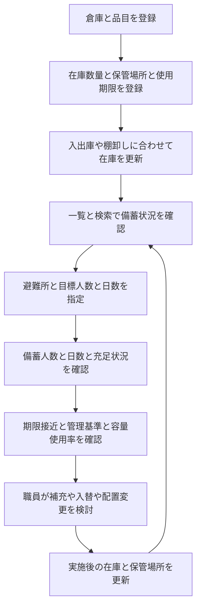

# UnFire 詳細要件定義書【89件統合版】

作成日：2026年11月1日（日本標準時）／版：2.0  
対象：6人チームによる、品川区防災課の平常時備蓄管理支援システム試作

## 1. 文書の位置付けと統合判定

『プロジェクト概要.md』を業務背景・事実・出典の原本とし、今回提供された『UnFire_設計質問回答記録.txt』のQ01〜Q75、P01〜P06、U01〜U08の全89件を統合した。75問未取得による前版の留保を解除する。全89件を付録Bの要件・検証対応表に掲載し、原本全文と提供された回答記録全文を付録に保持する。

回答記録は原質問見出し・本人回答の抜粋と、補足要約を分けた資料である。本書の確認範囲はその提供ファイルと取得済みP・U会話の照合であり、今回ブラウザーで過去会話全体を独自に再確認したという意味ではない。記録中の過去の作業報告は資料の説明として扱い、本書自身の実施実績に読み替えない。

判定：全89件の設計判断を保持した要件書への統合は可能。本書に統合済み。業務上の意味を変えない物理設計・画面・APIへの具体化へ進める。§15に残す実際の差分・外部確認を、実装完了や教員承認済みという表現で消さない。

原本の調査基準日は2026年7月17日、概要更新日は10月15日である。原本が「確認済み事実」とした公開情報は原本時点の根拠区分を維持し、今回の再調査済み・現在値への更新とはしない。原本中の「設計時に確定」「要ヒアリング」と、後続の内部判断で確定した試作仕様を区別する。

## 2. 出典・優先順位・承認

| 記号 | 資料 | 扱い |
|---|---|---|
| S0 | 直下『プロジェクト概要.md』 | 今回指定の原本。事実・分析・要ヒアリング・出典を維持 |
| D | 今回提供『UnFire_設計質問回答記録.txt』 | 内部設計判断89件。抜粋原回答と補足要約を区別 |
| S1 | 直下『実装計画_修正版.txt』、10月31日修正 | 今回本文を直接確認した計画。Q01に従い計画間の相違検討の基準。正式最新版との同一性は未認定 |
| S2 | 直下『DB設計書.docx』、本文10月16日改訂2 | 既存設計。本文・表の文字を確認。T3技術案は当時の案として区別 |
| S3 | outputs/db_design_20261016_revision2/sources のU1・U2・U3回答記録 | 旧確認記録。DのQ・P・Uの番号と混同しない |
| S4 | outputs/implementation_plan_revision_20261031/実装計画_差分と未確定事項.txt | 旧計画の担当・日程に関する二次根拠 |
| R | review_20261031/UnFire_刷新資料レビュー.md | 過去の画面・ER等のレビュー。今回全画像・セルを再検証したとはしない |
| C | 『対応事項の整理』会話、ID 6ae559b4-0900-83ec-ac99-7ef8fe06a591 | 今回取得できたP・U本人回答とレビュー |

Q01は最新の修正版実装計画を基準とする決定である。その決定と、今回読んだローカル同名ファイルが正式最新版であることの証明は別である。S1にない追加仕様はDの後続判断として明示し、旧仕様へ戻さない。業務事実はS0の根拠、内部要件はDの最終回答と後続具体化、予定と担当はS1・S4の確認範囲を用いる。

Q04は最終C、Q32は最終Aを採用する。Q02はA・Bの複数選択のまま保持する。Q68はU02、Q75はU08で具体化し、既存決定の撤回と扱わない。内部機能・業務ルール・画面・DB方針の最終承認者は本人である。教員の課題条件と品川区の現行業務に関する事実確認は内部承認で代替しない。

## 3. 業務背景・目的・対象範囲

S0によれば、防災課避難体制係が備蓄物資を所管し、約9万人の避難所避難者を基礎に区はおおむね1日分を備蓄する。避難所倉庫を中心に集中備蓄倉庫5か所、分散備蓄倉庫25か所が補完する。備蓄数量は2026年3月時点、避難所52か所は2025年度資料の値であり、別時点の数値を混ぜない。東京都の食料21万食の2024年事前配置も背景情報である。

旧なぎさ会館の活用、1,294m²の面積、倉庫スペース枯渇、2023年度からの民間賃借、年間約2,600万円の経費削減見込み、全品目の数量・単位は付録Aの原文と公開出典を保持する。面積をm³容量に無断換算しない。公表数量から倉庫別在庫・使用期限を推定しない。

現行の台帳・内部システム、棚卸し頻度、更新責任、期限切れ・補充漏れの発生は未確認である。「紙とExcelに分散」「期限切れ多発」を業務事実として追加しない。試作のフローは想定業務であり、品川区の現行手順確認済みではない。

目的は倉庫、品目、数量、期限、場所、容量を一元管理し、避難所別に目標人数・日数に対する充足状況を示して職員の補充・入替・配置判断を支援すること。主利用者は避難体制係、在庫更新職員・倉庫管理担当、関連資器材担当を想定する。実運用の責任分担は要ヒアリング。

必須範囲は在庫管理、入出庫、検索、期限・容量・基準比較、共有割当、備蓄計算、明示保存と履歴、人口・境界の参考GIS表示である。初期計算は食料・飲料水・携帯トイレ。施設収容人数の算定、人口からの需要人数自動設定、災害時の実避難者・消費・補給変動予測、物資配分自動決定、配送・配車・外部要請・自動通知・複雑な承認・区民公開・実個人情報は対象外。

## 4. 用語・状態と業務機能

| 要件ID | 入力・処理・出力・禁止条件 | 決定 |
|---|---|---|
| F01 倉庫 | 一覧・詳細、名称・施設種別・住所・位置・容量の登録・編集。削除・無効化機能は作らない | S0、Q16・27・32 |
| F02 品目 | 名称・分類・単位・容積・分割可否・登録状態。品目の保存期間とロット番号を管理しない。基本備蓄量は倉庫×品目 | Q05〜07・50〜53 |
| F03 在庫 | 倉庫・品目・場所・期限・数量を管理。通常一覧・検索・計算から論理削除・統合元を除外し、履歴参照を保持 | S0、Q29〜31・41 |
| F04 入出庫 | 増減と履歴を一括保存。数量負数や割当合計未満の出庫を拒否。登録日時のみ自動記録し、別処理日入力は設けない | Q08〜10・15 |
| F05 担当者 | 事前登録された一覧から選びIDを履歴に保存。追加・編集の管理画面は実装しない | Q09・17 |
| F06 倉庫対応 | 避難所を起点に専用・共有の設定、対応、在庫IDごとの割当を編集。総数量・割当済・未割当を表示 | Q03・14・16・65・67 |
| F07 設定状態 | 避難所ごとに設定中／完了を保持。対応変更は影響する旧先・新先を設定中へ戻し再確認 | P02、U01 |
| F08 変更制約 | 区分・対応先変更は有効在庫レコードも有効割当もない場合のみ。数量0の有効行も変更禁止対象 | Q68、U02 |
| F09 避難所 | 名称・住所で検索。目標人数・日数を保存し計算の初期値に使用。一時試算、正式目標更新、結果保存を別操作 | Q13・33 |
| F10 期限 | 期限あり・期限不要・期限未確認を明示。期限訂正は在庫詳細から個別実施し、変更前後の状態・日付・職員ID・日時を履歴保存 | Q41〜43 |
| F11 期限警告 | 一覧・詳細に加え管理画面上部に期限接近・切れ・未確認件数と対象への導線。品目別日数は必須、初期値なし、1〜3650整数。日数変更履歴なし | Q45〜49 |
| F12 容量・管理基準 | 容量概算、率、超過と基準未満を表示。情報不足は理由を伴う計算不可。異単位の数量を無意味に足さない | S0、Q06・19・66 |
| F13 品目グループ | 同じ需要を満たす旧新品目を明示関連付け、共通単位へ換算集計。物理在庫は統合しない。計算条件画面で管理し、変更時は簡易確認 | Q54〜57 |
| F14 計算表示 | 品目別結果、総合最小人数・日数、制約品目、条件・根拠・警告を表示。主要結果を常時表示し詳細は展開式 | Q11〜13・58・69・72 |
| F15 保存・訂正 | 一部計算不可も理由付きで手動保存。履歴を避難所・計算日時・状態で絞込み。編集・削除・無効化・上書き不可。訂正元計算IDを任意関連付け | Q59〜64 |
| F16 GIS | 実倉庫位置、サンプル在庫、町丁目の実人口・境界。密度色分け、総人口詳細、人口レイヤー切替、横概要パネル、静的差替え | Q20〜27 |

施設の分類と、計算上の専用・共有は別概念。期限不要（適用なし）は日付不明の期限未確認とは別。数量0の有効行、削除済み行、統合元行も区別する。統合と削除、復元と入出庫取消、目標更新と結果保存を同一操作にしない。

## 5. 入出庫・統合・削除・復元

### 5.1 入出庫と取消

更新後在庫＝更新前在庫＋入庫−出庫。割当合計≦現在庫を維持し、出庫後数量が割当を下回れば拒否する。職員が先に割当を修正するか出庫数を減らす。自動割当調整はしない。入出庫の誤りは元記録を残す条件付き取消と、正しい取引の再登録で訂正する。取消後の負数・割当未満は拒否する。登録済み担当者IDとシステム登録時刻を保存し、任意理由の既存要件を維持する。

統合後に統合前取引を直接取消することは禁止（Q04・10）。旧DB技術案の「統合先をたどって取消」は採用しない。統合後に統合先へ新規登録した取引の取消は、通常の条件を満たす場合の取消として区別する。二重取消、途中失敗で数量だけが変わる等を防ぐ技術設計を行う。

### 5.2 在庫統合

統合元・先の倉庫、品目、単位、使用期限が一致する在庫のみを対象とし、期限未確認は確認するまで統合禁止（Q40）。割当中は統合を拒否して先に解除・調整を求める（Q28）。統合前に元・先・数量・統合後状態・取消制限をプレビューし確定する（Q38）。

統合元は物理削除せず、F22自己参照で元先関係を保持する（Q29）。統合元と統合先を現在庫・備蓄計算に重複計上せず、元履歴は残す。統合自体の取消は実装せず、誤統合は個別訂正（Q39）。その訂正を過去履歴の削除・統合取消の隠れた実装にしない。F22の保持は内部判断として確定だが教員適合は未確認。

旧資料は保管場所も同じ在庫を統合する案で、Q40の選択文は場所条件を列挙していない。場所が違う在庫の統合可否と統合後保管場所は§15に差分として残す。同一倉庫・品目・期限・場所を通常入庫でまとめる既存方針と、手動統合の許可条件を混同しない。

### 5.3 論理削除・復元・登録終了

在庫削除はすべて論理削除（Q30）。割当が残れば削除禁止という既存制約を維持し、解除後に確認付きで実行する。削除で過去履歴・参照・保存計算を消さない。削除済み一覧から復元前に数量・期限・統合状態を確認し、操作記録を残す（Q31）。統合済みは通常復元対象外。過去取引・保存計算は復元でも変えない。

既存在庫のある品目の管理単位は直接変更せず新品目IDを作る（Q50）。旧品目は登録終了として新規選択から除外し、新規在庫登録・追加入庫を禁止（Q51・52）。出庫、履歴参照、条件を満たす取消、計算対象としての既存在庫は維持する。終了品目の再有効化と在庫復元は禁止（Q53・P01）。担当者管理画面なし・倉庫無効化なしを旧設計に逆戻りさせない。

## 6. 倉庫・避難所対応と割当

共有は在庫ID単位の明示割当のみを避難所へ算入し、未割当は倉庫残余として別表示する（Q14・65）。同じ在庫を複数避難所へ全量算入しない。専用は1避難所へ利用可能在庫全量を個別割当なしで算入する（Q67）。対応関係は関係テーブルに一元化し、専用の1避難所制約を検証する（U07）。対応件数や施設分類から専用・共有を推定しない。

設定完了・対応倉庫0件は正常な対象在庫0、設定中は未確定として区別（P02）。不整合時は確認済み数量を参考表示し、確定できない品目の正式充足率と総合人数・日数を計算不可にする（Q69）。正常な共有割当0もエラーにしない。

区分・対応先変更は有効在庫行も有効割当もない場合のみ許可（U02）。論理削除・統合元の無効行を有効行と混同しない。変更後は影響する旧先・新先を設定中へ戻す（U01）。名称・住所等の帰属に影響しない編集にはこの再確認を適用しない。専用の通常状態が0件・複数対応になる更新を拒否する。

倉庫区分・対応先の専用変更履歴は作らない（P03）。過去取引表示に現在の倉庫区分を載せるなら「現在の区分」と表示し取引当時と誤認させない。保存計算には当時の区分・帰属を別に残す（U05）。

## 7. 使用期限・容量・日常管理基準

期限状態は明示保持し、日付NULLだけで期限不要と未確認を表さない。日本標準時の期限当日終了まで使用可能、翌日から期限切れ（P06）。期限切れは備蓄計算から除外するが物理数量・記録は残す（Q44）。期限未確認も警告付きで暫定算入する（Q18）。警告を出さず通常の期限内扱いにしない。

期限接近日数は品目登録時必須・自動初期値なし・1〜3650整数（Q47・49）、品目画面で変更できるが変更履歴は保持しない（Q46・48）。期限そのものの変更履歴（Q43）とは別である。既存データの日数欠損は架空の初期値を埋めず、補完対象と明示する。期限切れ、接近、未確認の件数と一覧導線を管理画面上部に示す。

使用容量＝Σ（物理在庫数量×品目単位容積）、使用率＝使用容量÷保管可能容量×100%。単位はm³、容量は通路・作業スペースを除く既存定義を維持する。期限切れも現物が存在する限り容量から除外しない。容積欠損や容量未設定・0は計算不可とし不足情報と理由を示す（Q19）。使用容量＝容量は満杯、超えた場合が容量超過。欠損を0とした率を表示しない。

基本備蓄量は倉庫×品目（Q06）。保管場所・期限をまたいだ同倉庫同品目の使用可能数を比較し、異なる在庫単位を足さない。旧資料は期限未確認を日常管理基準集計から除外する。Q18が明示した変更範囲は備蓄計算なので、日常比較へ暫定算入を自動拡張しない。この集計での扱いは旧資料との境界として§15に記録する。

倉庫単位の総保管数量・割当済・未割当・期限状態まで集計し、全倉庫合計・地域別在庫集計を作らない（Q66）。「総保管数量」は同一単位・品目別等の比較可能範囲を保ち、箱・L・食を足した単一数値を作らない。

## 8. 備蓄計算・品目グループ・精度

### 8.1 入力と集計

避難所の登録済み目標人数・日数を初期表示し一時試算を許可する。正式目標更新と結果保存は別操作（Q13）。人数N、日数Dは既存要件に従い1以上の整数。使用量uと換算係数kは正、在庫・割当は0以上。基準の出典・版または更新日・適用条件を記録し、採用実値を推測しない。

実行当日の日本標準時を基準日として自動使用し、過去日・未来日指定は拒否（U06）。基準日と目標日数を混同しない。削除・統合元・期限切れを外し、期限未確認は警告付き暫定算入。専用全量・共有割当分を算入し、未割当を自動配分しない。

同じ備蓄需要を満たす旧新品目は明示した品目グループと共通単位へ換算して集計する（Q54・55）。名前が似ているだけでは同グループにしない。管理は計算条件画面、変更は簡易確認ダイアログ（Q56）。物理在庫の統合は行わず、登録終了の既存在庫も対応関係があれば計算へ含める。同じ需要グループを別々の必要量として二重要求せず、食・L・回分の異なる需要を合計しない。

### 8.2 式と結果

| 結果 | 定義 |
|---|---|
| 必要量R | N×D×u。分割不可の計算単位は切り上げ |
| 算入数量A | 専用利用可能量と共有割当分を登録係数で共通計算単位へ換算して集計 |
| 充足量 | min(A,R) |
| 不足量 | max(R−A,0) |
| 充足率 | A÷R×100%。100%超も表示 |
| 指定人数を支えられる日数 | A÷(N×u)、最終値を整数へ切り捨て |
| 指定日数を支えられる人数 | A÷(D×u)、最終値を整数へ切り捨て |
| 全対象需要を確保できる目安 | 対象ごとの人数・日数の最小と制約品目を併記 |

情報が揃う品目だけ結果を示し、欠損品目は計算不可と理由を表示する。全品目の評価が必要な総合人数・日数は算出不可（Q58）。倉庫対応が不確定なら正式率も出さず、確認済み数量のみ参考とする（Q69）。在庫未登録・基準未設定を確認済み0と同一視しない。表示名は「備蓄で支えられる人数・日数の目安」で、収容人数・実災害の保証期間ではない。

### 8.3 入力・保存・丸めの統一

換算係数は小数第2位までの正値、100倍したINTEGER保存、計算・表示時に戻す（Q73）。その他の数量・容積・使用量・小数結果はREAL基本（P04）。分割不可単位の数量は整数、それ以外は小数第2位まで入力可能、桁超過は拒否し黙って丸めない（U03）。ID・人数・日数等の整数はINTEGERとする。

計算途中は小数第2位まで四捨五入、中間値は5以上切り上げ（Q57・72、U04）。最終人数・日数は整数へ切り捨て、整数単位の必要調達量は切り上げ、充足率は小数第1位表示。充足判定に表示用の丸め済み率を使わない。旧日数小数第1位四捨五入表示を採用しない。

微小不足への追加補正・特別検出は行わず、0.004Lが0.00Lになる可能性を許容（P05）。REALの十進近似も既知制限。指定の十進丸めを実現する方法と演算ステップは技術設計で固定し、同じ入力から同じ結果になるよう単体試験とスナップショットに対応させる。言語既定の偶数丸めを無条件採用しない。2桁で表せない小容積を0へ変換する等の暗黙移行は禁止し、必要なら要件変更として本人承認する。

試験用仮定：N=100、D=2、u=3L、A=600LならR600、不足0、率100%、日数2、人100。A300なら不足300、50%、日数1、人50。A450なら不足150、75%、日数1（1.5の整数切捨て）、人75。A900なら充足量600、率150%、日数3、人150。この3Lは採用実基準ではない。

期間中の期限到来には注意を示すが、日々の消費・補給・人数変化による予測には拡張しない。警告の期間終端の包含と個々の途中丸めの実装箇所は明示して一貫させ、入力・精度規則を変更する口実にしない。

## 9. 結果保存・訂正・履歴

保存ボタンでのみ記録し、自動保存しない（Q11）。計算条件未完の一部計算不可結果も、状態・不可品目・理由・条件を保存できる（Q59）。主要結果は常時、詳細根拠は展開式表示（Q12）。履歴は避難所・計算日時・状態で検索し詳細閲覧、専用2件比較機能なし（Q60）。

保存済み結果の編集・上書き・削除・無効化は禁止し、訂正は新しい結果として保存（Q61）。任意の訂正元計算IDを関連付け、旧結果を変えず訂正関係を閲覧する（Q62）。新結果の保存前に既存訂正元の存在を検証し、関連表示で循環や不正参照を作らない方法は技術設計とする。

主要な写しは計算時点の品目・グループ・単位・数量・割当・換算・使用量・結果・期限未確認警告・不可理由・出典・条件と、当時の倉庫区分・帰属・主要算入数量（Q63、U05）。在庫レコード全体の完全複製へ拡張しない。名称等も結果解釈に必要な当時の根拠として保存する。

計算時の結果と根拠一式を保持し、そのまま保存する。計算日時と保存日時を区別し、保存直前の変更検出・再計算強制を実装しない（Q64）。保存時に現DBから写しを作り直して古い結果と混在させない。過去結果閲覧も現マスター・現倉庫区分で再計算しない。期間経過による自動履歴削除をしない既存方針を維持する。

## 10. GISの確定範囲

G01：倉庫ピンを常時表示し、町丁目単位の人口分布・区域境界を参考表示する（Q20・22・23）。人口密度で色分け、総人口は詳細情報へ（Q24）。ピン選択時は地図横の概要パネル、詳細は既存倉庫詳細画面（Q25）。人口レイヤー切替が倉庫ピンを消す仕様にしない。

G02：公開根拠で検証した実際の倉庫位置、実人口・区域境界、架空と明示したサンプル在庫を使用する（Q21）。座標未確認でも倉庫登録・在庫管理は許可し、地図から外し別一覧へ（Q27）。不明を0,0で表示しない。

G03：人口・境界は開発時取込の固定データ、更新は開発担当者の差替え（Q26）。出典、人口基準日、境界版・区域コード、人口と境界の対応、座標系、密度に用いる面積と単位を検証・記録する。人口密度は同じ区域の人口÷面積で扱い、面積欠損・0を0密度としない。具体的な色階級は凡例と一緒に技術設計で定める。データの格納をSQLite・静的ファイルのどちらにするかは技術事項。

G04：人口から避難者数や不足を自動算定しない。町丁目は参考レイヤーで、区域別在庫集計・地域充足率・全倉庫集計はQ66により対象外。倉庫所在区域と供給対象区域、人口と目標人数を区別する。公開総量を人口比例配分して実在庫に見せない。異なる区域階層を未検証で木構造にしない。

人口CSV・境界原データの収集・検証・利用条件確認は今後の実装作業であり、本書作成で実施済みとはしない。固定データの採用決定が確定したことと、データ取得完了は別である。

## 11. SQLite DB・画面・API要件

SQLite採用は内部要件として確定（Q71）。教員指定・計画との外部整合は別途確認。Q34に従い本格実装前にDDLを確定する。基本制約はPK・FK・NOT NULL・UNIQUE・CHECK、全接続でFK有効化。行をまたぐ割当合計・統合・削除・訂正等はアプリ検証と関連更新トランザクションで保証（Q35・74）。単一編集者前提でも操作の一体性は必要。DB直接編集による業務検証迂回の制限を許容し、通常運用は直接編集しない。

| 論理データ | 既存物理名／追加設計候補 | 最低限の対応 |
|---|---|---|
| 倉庫 | warehouses | 名称・施設種別・計算区分・住所・座標・容量。削除機能なし |
| 品目 | items | 単位・容積・分割可否・登録終了・期限接近日数1〜3650 |
| 在庫 | stocks | 数量・場所・期限状態／日付・論理削除・統合先F22 |
| 避難所 | shelters | 名称・住所・目標・倉庫設定状態 |
| 倉庫対応 | shelter_warehouses | 一元管理、重複禁止、専用1避難所、変更時状態更新 |
| 共有割当 | stock_allocations | stock_id×shelter_id、数量、対応検証、上限検証 |
| 使用量・換算 | usage_standards等 | 正値、共通計算単位、係数100倍INTEGER、出典・版・条件 |
| 日常基準 | stock_thresholds | 倉庫×品目の基準、品目登録画面から分離 |
| 担当者 | operators | 事前登録一覧のみ、管理画面なし |
| 入出庫 | stock_movements | 元取引、担当者ID、登録日時、取消状態・情報 |
| 期限変更・復元記録 | 追加の履歴構造を具体化 | Q43の変更前後と職員・時刻、Q31復元操作 |
| 品目需要グループ・対応 | 追加構造を具体化 | Q54・55、旧新の明示対応、共通単位と換算 |
| 計算・品目結果・主要写し | calculation_runs等の既存4表を改訂 | 状態・部分不可・主要根拠、計算／保存日時、任意訂正元計算ID、当時の帰属 |
| GIS参考データ | 版付き静的ファイルまたは表 | 町丁目コード・人口・面積・境界版・出典・欠損を管理 |

旧14表106列を最新確定物理設計としない。新しい住所・状態・グループ・期限変更履歴・訂正元等の反映で列・表が増える可能性がある。DのU07補足のwarehouses.kindと、旧DBのkind＝施設種別・allocation_mode＝専用共有は語の違いがある。概念を維持して対応表で物理名を固定し、施設種別を消したり専用共有の真実を二重に持たない。

画面は倉庫・品目・在庫一覧詳細と編集、入出庫／履歴、削除済み復元、統合プレビュー、避難所名称住所検索、対応割当・設定確認、計算条件・グループ、計算・保存履歴・訂正リンク、GISを整備する。ロット番号・品目保存期間・品目の基本備蓄量・処理日入力・担当者管理画面・倉庫無効化を作らない。APIも同じ禁止条件を適用し、画面上の無効化だけで済ませない。

Q37に従い入力エラー・保存失敗は原因と修正方法を示し入力内容を保持する。未登録・未設定・確認済み0・計算不可・暫定結果・保存成功を別表示にする。認証済み操作者と選択担当者を同一視せず、画面の管理者呼称だけから本格認証・権限機能を追加しない。

## 12. ER図と教員条件

Q02のA・Bは、本人が記憶する「循環参照修正」「ER図全体をツリーにする」という指摘の記録である。対象線・対象図・F22自己参照や訂正元計算IDを許すかは未確認。Q70に従い正確な物理ER図と簡略な主要構造説明図を別々に作る。必要な共有関係・F22を説明の都合だけで削除・複製しない。説明図が木に見えることを物理DBが単一ツリーである証拠にしない。教員へ対象・意味を確認するまで対応完了としない。

## 13. 非機能・既知の限界

通常利用・発表環境の安定、保存失敗の明示、数量・単位・日付の検証、一覧・詳細・容量・計算への更新反映を優先（S0 §11）。オフライン同期は対象外。サンプル在庫は架空明示、実個人情報なし。実運用前に保管場所等の公開範囲と更新責任を確認する。

既知の制限：単一担当者編集（Q36）、統合前取引の統合後直接取消禁止と統合取消なし（Q04・10・39）、担当者管理画面なし（Q17）、倉庫無効化なし（Q32）、GIS静的差替え（Q26）、専用2件比較なし（Q60）、保存結果変更・削除・無効化なしと保存前変更検出なし（Q61〜64）、全倉庫・地域集計なし（Q66）、倉庫区分変更履歴なし（P03）、REAL近似（P04）、微小不足消失（P05）、2桁入力精度（U03）、当日のみ（U06）、DB直接編集で業務検証を回避し得る（Q74）。これらを未決定と扱わない。

容量・対応可能人数日数は登録値と条件による目安であり実保管可否・災害時生存期間を保証しない。測定していない改善率、処理秒数、同時利用人数等を確定目標として捏造しない。

## 14. 検証条件

以下は未実施の受入検証設計。付録Bで全89件を要件と検証へ対応付ける。合格済みを意味しない。

| 検証ID | 条件と期待結果 |
|---|---|
| V01 文書・範囲 | Q04最終C、Q32最終A、Q02複数選択を保持。削除対象のロット等と対象外機能が画面・DB・APIへ混入しない。Q01の計画正本指定と外部承認を区別 |
| V02 入出庫・取消 | 在庫10・割当8で出庫3拒否、2許可。取消後の負数・割当不足拒否、元記録保持。統合前取引を統合後に取消拒否。担当者事前選択・登録日時のみ、保存失敗時の入力保持 |
| V03 統合 | 元先条件一致・未確認期限・割当中・条件不一致を比較。拒否で数量変更なし。確定前プレビュー、F22元先保持、二重計上なし。統合取消経路なし。異場所は§15確定後に期待値固定 |
| V04 削除・復元・終了 | 論理削除で一覧から外れるが履歴保持。割当中削除拒否。復元操作記録。統合元・登録終了品目の復元拒否。終了品目の入庫／再有効化拒否、出庫・有効取消・計算は維持 |
| V05 対応・設定 | 専用対応0／1／2件の検証。共有全量の二重算入なし。数量0有効行でも区分変更拒否。無効行のみの変更条件、旧新先の設定中遷移、名称編集時は遷移なし。設定完了0件と設定中0件・共有割当0を区別 |
| V06 期限・容量 | 日本時間期限当日／翌日、期限なし／未確認、暫定警告、物理在庫保持。期限変更履歴の前後・職員・時刻。日数未入力・0・1・3650・3651、初期値なし、日数履歴なし。管理画面件数・導線。容積欠損／容量0／容量100%／超過の区別 |
| V07 計算・グループ | §8の600／300／450／900Lを検算。整数日数切捨てと100%超を確認。旧新単位の明示グループ集計、物理在庫は別。無関係品目を自動集約しない。条件不足品目のみ不可・総合不可、確認済み0は正常 |
| V08 精度 | 分割不可1.5拒否、小数可1.23許可・1.234拒否、係数正値2桁と100倍INTEGER。1.245→1.25、1.244→1.24、微小不足0.004→0.00を特別補正しない。表示率で判定しない。過去・未来基準日拒否 |
| V09 保存・訂正 | 一部不可も理由付き保存、目標更新との分離、計算後のDB変更でも計算時根拠を保存し時刻を区別。主要写しで当時の区分・帰属・警告を再現。旧結果不変・削除不可、訂正元任意関連、条件検索と詳細、専用比較機能なし |
| V10 GIS・検索 | 実位置・実人口境界と架空在庫の明示、町丁目密度と総人口、ピン常時・人口切替、横概要と詳細遷移、座標不明別一覧。版とコード・面積単位照合、固定差替え。人口自動需要計算・地域在庫集計がないこと。避難所名称住所検索 |
| V11 DB・ER・運用 | 全接続FK、基本制約、割当等の関連更新の失敗時全取消、参照・自己循環の防止。正確な物理図と説明図の対応。単一編集者・通常DB直接編集なし。教員適合と設計案／実装実績を区別 |
| V12 一連操作・評価 | 原本§9.2の地図→検索→避難所と目標→不足→入庫→保存確認・再計算→出庫→期限容量確認を実施。画面反映、職員判断、実装者以外の操作を確認。想定台帳との比較時間・正確さを測り、現行区業務の実改善と断定しない |

## 15. 保留・具体化・外部確認の区別

全89件は決定済みであり、75問未取得による保留は解消した。新しい選択式質問は追加しない。ただし、提供記録自体が明示的に残す次の境界は、決定済みと偽らず局所的な整合確認として扱う。

| 分類 | 残る内容 | 扱い |
|---|---|---|
| 内部業務ルールの資料間差分 | Q40の手動統合条件に場所が列挙されず、旧DBは同一保管場所条件。異場所統合の可否と統合後場所は一義的に確定できない | Q40で列挙された条件・Q28等は確定。異場所だけは許可済みとも禁止済みとも断定せず、該当処理の実装前に本人が差分を整理 |
| 適用範囲の差分 | Q18は備蓄計算の期限未確認暫定算入。日常基準比較まで変更する記載はなく旧資料は除外 | 日常比較は旧除外を維持した暫定統合。変更を意図する場合だけ内部変更として扱う。備蓄計算への暫定算入は確定済み |
| 技術的具体化 | 物理名と区分概念、状態値、追加表・列、丸めの演算段階、期間警告終端、トランザクション、API・画面配置、密度凡例 | 確定した精度・丸め・算入・禁止条件を変えず設計。新規の業務選択質問へ拡大しない |
| 設定実値 | 使用量・出典・版・条件、換算、日常基準、期限接近日数、位置、在庫・容積・容量・割当 | 採用方式と実値設定は別。試験値と運用確認値を分ける。推定の既定値で埋めない |
| 外部確認 | 教員の木構造対象・正式提出物・SQLite等の課題条件、正式発表・休講日、正本最新版との同一性 | 未確認と維持。本人の内部承認で完了扱いにしない |
| 実業務事実 | 区の現行運用、専用共有モデルの実運用との一致、更新責任、公開範囲 | 根拠・ヒアリングで確認。内部試作モデル確定とは別 |

本書は文書の統合作業であり、既存Word・Excel・ER・DB・コードを書き換えたものではない。設計物の反映、実DB・アプリの試験、公開GISデータ取得、教員適合は未完了。付録の原本・旧文言は保存資料として掲載し、本編の後続確定判断を取り消すものではない。

## 付録A. 原本『プロジェクト概要.md』全文

以下は指定原本の保存部分。原文の要確認・旧仕様は本文の後続確定判断を取り消さない。出典URL・頁・時点・業務事実・分析・要ヒアリングを保持する。

<!-- SOURCE_S0_BEGIN -->
# 品川区防災課の平常時備蓄管理業務の調査とシステム概要

調査基準日：2026年7月17日  
システム概要更新日：2026年10月15日  
対象：品川区防災課の平常時の備蓄管理業務  
用途：6人チームによるシステム企画・要件検討

## 1. 結論

本プロジェクトでは、品川区防災課が平常時に行う備蓄管理を支援する。対象は、倉庫、品目、在庫数量、使用期限、保管場所、倉庫容量の管理である。避難所ごとに、備蓄で支えられる人数・日数の目安と、目標人数・日数に対する必要量、充足量、充足率、不足量を表示する。備蓄状況を把握しやすくし、職員による補充、期限に応じた入替、配置の判断を支援する。

公開資料にある多様な備蓄品、複数の保管拠点、倉庫容量不足を踏まえ、次のシステムを開発する。

> 倉庫、品目、在庫数量、使用期限、保管場所、倉庫容量を一元管理し、避難所別に備蓄で支えられる人数・日数の目安と目標に対する充足状況を表示する。一覧、検索、期限表示、容量表示、簡易地図と合わせて、職員の補充や配置の判断を支援する「平常時備蓄管理支援システム」

この概要は、「品川区防災課_平常時備蓄管理支援システム_開発計画.docx」の追加機能を含む開発範囲に合わせている。「夏休み進捗報告.pptx」は企画の背景として参照する。平常時に入力した目標人数・日数に対する不足量の計算は対象に含める。災害発生後の避難者情報管理、変動する人数・消費・補給を踏まえた不足量・不足時期の予測、物資配分、配送計画、外部要請は対象外とする。補充量や配置先の最終判断は職員が行い、システムは判断に必要な情報を提供する。

この提案が品川区防災課の業務に対応すると判断した理由は、公式資料に次の業務が明記されているためである。

- 防災課避難体制係は、備蓄物資に関する業務を所管している
- 約9万人の避難所避難者を基礎として、区はおおむね1日分を備蓄している
- 避難所倉庫を中心に、集中備蓄倉庫と分散備蓄倉庫から不足分を補う計画である
- 食料、飲料水、毛布、携帯トイレなど、多様な備蓄品を管理する必要がある
- 備蓄倉庫は施設ごとに保管容量や搬出入条件が異なる
- 区全体で倉庫容量が不足し、民間倉庫の賃借と旧なぎさ会館の活用が必要になった

一方で、公開資料だけでは、現在の内部システム、台帳形式、更新手順、品目別の配置数、使用期限、倉庫ごとの空き容量までは確認できない。したがって、「紙やExcelに分散している」「期限確認を手作業で行っている」といった表現は、現時点では事実として扱えない。これらは職員へのヒアリングで確認すべき事項である。

## 2. 調査範囲と判定方法

### 2.1 調査対象

本調査では、品川区が公開している次の情報を中心に確認した。

- 品川区地域防災計画 令和7年度修正
- 同計画の別冊資料
- 品川区災害時受援計画 令和3年4月
- 防災課の組織と仕事
- 令和5年度政策評価結果報告書
- 令和7年度の建設委員会所管事務概要
- 令和7年12月17日の区政運営会議資料
- 災害時物資輸送等に関する協定の公表資料
- 東京都からの食料事前配置に関する公表資料
- 区が公開する災害時協定一覧

本報告書では、これらの資料のうち、備蓄品の種類と数量、保管場所、倉庫容量、備蓄配置に関する記述を、平常時の備蓄管理の背景として使用する。受援計画や協定資料に記載された災害時の調達・輸送業務は、関連業務を理解するための参考情報であり、システムの実装要件には含めない。

### 2.2 情報の区分

本報告書では、記述を次の三つに分ける。

| 区分 | 意味 |
|---|---|
| 確認済み事実 | 品川区または品川区議会の公開資料に明記された内容 |
| 分析 | 複数の確認済み事実から、本調査で導いた業務上の解釈 |
| 要ヒアリング | 公開情報だけでは確認できず、職員への確認が必要な事項 |

### 2.3 資料の時点差

数量や施設数は、資料の作成時点により異なる。たとえば、令和7年度の所管事務概要は2025年度時点の数を示し、地域防災計画別冊資料は2026年3月時点の数を示す。本報告書では最新の現行計画を優先し、過去資料は当時の課題や業務手順を確認するために使用した。異なる時点の数を単純に増減比較していない。

## 3. 対象部署と業務の位置付け

### 3.1 防災課内の担当

確認済み事実として、防災課の公開ページには次の分担が示されている。

| 担当 | 本調査に関係する主な業務 |
|---|---|
| 計画担当 | 地域防災計画、災害協定、災害対策本部など |
| 避難体制係 | 避難所、避難場所、帰宅困難者、備蓄物資など |
| 防災設備係 | 初期消火設備、災害情報通信、消火器、防火水槽、給水設備など |

分析として、本システムの主な利用者は、備蓄物資を所管する避難体制係の職員を想定する。関連する資器材の担当者や倉庫管理担当者との役割分担、入力・更新の責任者は、ヒアリングで確認する必要がある。

### 3.2 現在案との関係

現在案は、平常時の備蓄情報を一元管理・可視化するシステムである。食料、飲料水、毛布、携帯トイレなどを品目として登録し、倉庫ごとの在庫数量、使用期限、保管場所、容量使用率を確認できるようにする。

追加機能として、各避難所の備蓄が人数規模や期間をどの程度支えられるかを確認できるようにする。食料、飲料水、携帯トイレを初期の計算対象とし、利用者が入力した人数・日数と使用量基準から、支えられる人数・日数の目安、必要量、充足量、充足率、不足量を表示する。

携帯トイレは備蓄品の一つとして扱う。現行の別冊資料には135万回分が掲載されているが、今回のシステムはトイレに限定しない。日常の在庫更新、期限確認、容量確認を通じて、職員が備蓄品の補充や配置を検討するための情報を提供する。

## 4. 備蓄計画の確認済み事実

### 4.1 計画の基礎

地域防災計画は、避難所避難者数を約9万人と見込み、区が必要量のおおむね1日分を備蓄するとしている。また、東京都からの輸送遅延に備え、品川区は2024年に東京都の備蓄食料21万食を区内へ事前配置した。

これらは、平常時に備蓄量と保管場所を把握する必要性を示す背景情報である。約9万人という想定や公表数量を、そのまま倉庫別・品目別の管理基準には用いない。基準を下回る在庫を表示する場合は、職員が設定する管理基準と、その対象範囲を確認する必要がある。

### 4.2 主な備蓄数量

現行の地域防災計画別冊資料に掲載された主な数量は次のとおりである。数量は2026年3月時点の公表値として扱う。

| 品目 | 公表数量 | 単位または補足 |
|---|---:|---|
| ビスケット | 90,000 | 食 |
| アルファ化米 | 180,000 | 食 |
| 梅がゆ | 8,700 | 食 |
| 粉ミルク | 696 | 缶 |
| アレルギー対応粉ミルク | 58 | 缶 |
| 飲料水 | 90,000 | リットル |
| カレー | 75,000 | 食、最終目標は90,000食 |
| 野菜ジュース | 90,000 | 缶 |
| ベビーフード | 15,252 | 袋 |
| 毛布 | 151,580 | 枚 |
| 携帯トイレ | 1,350,000 | 回分 |
| 紙歯磨き | 217,500 | 枚 |
| 間仕切り | 2,600 | 張 |

帰宅困難者向けの別枠として、アルファ化米51,800食、ビスケット30,240食、飲料水36,963リットルも掲載されている。

平常時の管理では、数量に加えて保管場所、使用期限、品目の容積を把握することが重要である。地域防災計画が求める食物アレルギー、宗教・文化、乳幼児、高齢者などへの配慮は、職員が品目構成を検討する際の背景となる。本試作では、個人の属性に基づく需要計算や物資の割当は行わない。

### 4.3 備蓄場所

現行計画では、物資を主に避難所倉庫と災害対策備蓄倉庫へ配置する。災害対策備蓄倉庫は次の二種類である。

| 種別 | 現行計画上の数 | 特徴 |
|---|---:|---|
| 集中備蓄倉庫 | 5 | 比較的大規模、荷役資器材あり、車両経路が良好、全避難所を対象として補完 |
| 分散備蓄倉庫 | 25 | 比較的小規模、近隣避難所を補完、車両経路や荷役条件に差がある |

合計は30か所である。これとは別に、避難所となる区立学校などにも避難所倉庫がある。2025年度の所管事務概要では避難所は52か所とされ、原則として1避難所当たり1,000人分、一部は2,000人分を備蓄すると説明されている。ただし、保管場所の制約がある。

地域防災計画は、狭い道路が多い地域では発災直後に車両輸送ができない可能性を明記している。このため、避難所倉庫の備蓄拡充、学校の空き教室利用、物資のコンパクト化が検討事項となっている。

### 4.4 倉庫容量不足

2025年12月17日の区政運営会議資料は、次の状況を明記している。

- 避難所環境の改善と多様な避難者への対応により、備蓄品は増加している
- 区全体で倉庫の保管スペースが枯渇している
- 2023年度から民間倉庫を賃借している
- 品川備蓄倉庫の建替えに伴い、一時移転先が必要である
- 旧なぎさ会館を2026年4月1日から一時的な集中備蓄倉庫として活用する

旧なぎさ会館は1,294平方メートルで、大井競馬場と京浜トラックターミナルに近く、幹線道路への接続、大型車の駐車、エレベーター、広い室内空間などの条件が評価されている。区は、民間倉庫を借りた場合との比較で、年間約2,600万円の経費削減効果を見込んでいる。

これは、保管容量と施設条件が実在する業務課題である。本システムでは、倉庫ごとの在庫、登録した品目容積に基づく容量使用率、簡易地図上の位置を表示し、職員が補充や配置を検討するための情報を提供する。物理的な保管面積の増加や配置先の自動決定は、システムの役割に含めない。

## 5. 平常時の備蓄管理業務

本プロジェクトで支援する業務は、備蓄品と保管場所の情報を登録し、日々の入出庫や棚卸しに合わせて在庫を更新し、期限と容量、避難所別の備蓄人数・日数と充足状況を確認することである。職員は表示された情報をもとに、補充、入替、配置変更を検討する。

### 5.1 管理対象

| 管理対象 | 本システムで扱う情報 |
|---|---|
| 倉庫 | 名称、種別、所在地、地図上の位置、保管容量 |
| 品目 | 名称、分類、数量単位、容量計算に使う単位当たり容積 |
| 在庫 | 倉庫、品目、数量、保管場所、使用期限 |
| 入出庫 | 対象在庫と入庫・出庫数量 |
| 避難所と在庫の対応 | 避難所、対応する倉庫、共有倉庫在庫の避難所別割当 |
| 備蓄計算条件 | 目標人数、目標日数、1人1日当たり使用量、数量単位、換算値、基準の出典と適用条件、基準日 |
| 計算結果 | 備蓄で支えられる人数・日数の目安、品目別の必要量・充足量・充足率・不足量 |
| 確認情報 | 期限接近、設定した管理基準を下回る在庫、容量超過 |

品目の数量単位と容積の単位を区別する。例えば、食料の「食」と梱包の「箱」を混同しないよう、必要な換算方法を設計時に確認する。

### 5.2 職員による判断とシステムの役割

システムは、在庫数量、期限接近、倉庫使用率、備蓄で支えられる人数・日数の目安と充足状況を表示する。購入数量、入替時期、移動先などの決定は職員が行う。管理基準を下回る在庫の表示に加え、平常時に設定した目標人数・日数と使用量基準に対する不足量を計算する。発災後の人数変化や消費・補給を踏まえた不足量・不足時期の予測は行わない。

### 5.3 現行業務の確認が必要な点

棚卸し、期限確認、入出庫登録の実際の頻度と担当者は、公開資料だけでは分からない。以下の業務フローは試作の想定であり、品川区の現行手順を確認済みの事実として示すものではない。

## 6. 平常時の業務フロー

### 6.1 主な操作

| 段階 | 想定する操作 |
|---|---|
| 基礎情報の登録 | 倉庫、品目、容量、位置を登録・編集する |
| 計算条件の登録 | 避難所と倉庫の対応、共有在庫の割当、使用量基準と出典、数量単位と換算値を登録する |
| 在庫の登録 | 倉庫と品目を選び、数量、保管場所、使用期限を登録する |
| 数量更新 | 入庫・出庫数量を入力し、在庫数量に反映する |
| 状況確認 | 倉庫、品目、期限で検索し、一覧と詳細を確認する |
| 備蓄目標の点検 | 避難所と目標人数・日数を指定し、支えられる人数・日数と品目別の必要量・充足量・充足率・不足量を確認する |
| 管理上の確認 | 期限接近、管理基準を下回る在庫、容量超過を確認する |
| 補充・配置の検討 | 一覧、容量表示、簡易地図を参考に職員が判断する |
| 実施後の更新 | 補充、入替、移動後の数量と保管場所を更新する |

## 7. 業務課題

### 7.1 公開資料から確認できる課題と支援範囲

| 課題・管理上の条件 | 根拠となる事実 | 今回のシステムで支援する範囲 |
|---|---|---|
| 倉庫容量の不足 | 区全体で保管スペースが枯渇し、民間倉庫の賃借や旧なぎさ会館の活用が必要となった | 倉庫容量、使用容量、使用率、容量超過の表示 |
| 複数拠点の備蓄管理 | 避難所倉庫、集中備蓄倉庫、分散備蓄倉庫に備蓄している | 倉庫別の在庫一覧・詳細と簡易地図 |
| 多様な品目の管理 | 食料、飲料水、毛布、携帯トイレなどを備蓄している | 品目別の数量、単位、保管場所、使用期限の管理 |
| 保管場所の制約 | 避難所ごとに備蓄量や保管条件が異なる | 倉庫別の在庫と容量を示し、職員の配置検討を支援 |

期限接近、管理基準を下回る在庫、備蓄人数・日数と充足状況の表示は、平常時の確認を支援するための提案機能である。現在の業務で期限切れや補充漏れが発生していることを、公開資料から確認したわけではない。

### 7.2 政策評価との関係

2023年の政策評価には、アレルギーなどへの配慮、在宅避難者や帰宅困難者を含めた適正な総備蓄量の検討などが示されている。これらは、職員が平常時に備蓄品の構成や量を検討する際の背景として参照できる。

本システムは、登録済みの備蓄情報と、利用者が入力した目標人数・日数に基づく充足状況を表示して検討を支援する。所在地や人口からの人数の自動推計、個人の属性に基づく適正量の自動算出は今回の試作に含めない。また、政策評価は2023年時点の資料であり、指摘事項が現在も全て未解決であるとは扱わない。

### 7.3 公開資料から導く分析

#### 分析A　数量と保管場所を合わせて把握する必要がある

同じ数量でも、品目の容積、使用期限、保管先によって管理上の意味が異なる。在庫情報を倉庫と品目に結び付けることで、職員がどこに何があるかを確認しやすくなる。

#### 分析B　期限と容量を一覧から確認できると検討に使いやすい

期限が近い在庫や容量を超える倉庫を一覧・詳細で確認できると、入替や配置変更を検討する材料になる。ただし、実際の確認時間がどの程度短縮されるかは、試作を使った評価が必要である。

#### 分析C　計算の前提を明確にする必要がある

容量使用率は、品目の単位当たり容積と数量、倉庫の保管容量に依存する。登録値が不明な場合に、空き容量があると誤表示しないようにする。また、平常時の在庫確認に使う管理基準と期限接近の判定日数は、職員への確認が必要である。

備蓄人数・日数と充足状況は、目標人数・日数、1人1日当たり使用量、数量単位と換算値、対象在庫の割当に依存する。採用する使用量基準の出典・版または更新日・適用条件を記録し、チームと利用者で確認する。同じ在庫を複数の避難所に重複計上せず、在庫や基準の未設定を在庫0と区別する。

#### 分析D　補充と配置の最終判断は職員が行う

実際に保管できる量は、棚配置、通路、搬出入条件などにも左右される。システムの容量表示は検討の目安であり、補充や配置先を自動決定するものではない。

## 8. 平常時備蓄管理支援システムの概要

### 8.1 名称

平常時備蓄管理支援システム

### 8.2 目的と対象業務

品川区防災課の平常時の備蓄管理を対象に、倉庫、品目、在庫数量、使用期限、保管場所、倉庫容量を一元管理・可視化する。避難所ごとに、備蓄が人数規模や期間をどの程度支えられるか、目標に対して何がどれだけ不足しているかを把握しやすくし、職員による補充、入替、配置の判断を支援する。

主に、次の情報を確認できるようにする。

- どの倉庫に、どの品目が、どれだけあるか
- 使用期限が近い在庫はどれか
- 設定した管理基準を下回る在庫はどれか
- 各避難所の備蓄で、指定人数を何日支えられるか、指定日数なら何人を支えられるか
- 目標人数・日数に対する品目別の必要量、充足量、充足率、不足量はどれくらいか
- 倉庫の使用容量と使用率はどれくらいか
- 倉庫はどこにあり、どのような備蓄状況か

### 8.3 対象ユーザー

| ユーザー | 主な利用目的 |
|---|---|
| 防災課避難体制係の職員 | 備蓄状況の確認、補充・入替・配置の検討 |
| 在庫更新を担当する職員・倉庫管理担当者 | 倉庫・品目・在庫の登録、入出庫に伴う数量更新 |
| 関連資器材の担当者 | 担当品目の在庫・使用期限・保管場所の確認 |

実際の利用者と更新責任者はヒアリングで確定する。区民向けの公開画面は今回の対象に含めない。

### 8.4 実装予定機能

| 機能 | 内容 |
|---|---|
| 倉庫管理 | 倉庫の一覧・詳細表示、情報の登録・編集 |
| 品目管理 | 品目の一覧・詳細表示、情報の登録・編集 |
| 在庫管理 | 倉庫ごとの在庫の登録・編集・削除、入出庫による数量更新 |
| 使用期限管理 | 在庫ごとの使用期限の記録、期限が近い在庫の表示 |
| 倉庫容量管理 | 倉庫ごとの使用容量・使用率・容量超過の表示 |
| 検索・絞り込み | 倉庫、品目、使用期限などによる検索 |
| 簡易地図 | 倉庫の位置と備蓄状況の表示 |
| 備蓄人数・日数の表示 | 避難所別に、指定人数を支えられる日数と指定日数に対して支えられる人数の目安を表示 |
| 充足状況の表示 | 目標人数・日数に対する品目別の必要量、充足量、充足率、不足量を表示 |
| 計算条件の管理 | 避難所と倉庫の対応、共有在庫の割当、使用量基準・出典・適用条件、数量単位・換算値を登録・編集 |

管理基準を下回る在庫の確認は、在庫情報の表示に含める。基準値と判定単位は設計時に確定し、災害時の需要予測や補充量の自動決定には拡張しない。

### 8.5 主要データ

| データ | 主な項目 | 使用場面 |
|---|---|---|
| 倉庫 | 名称、種別、住所、緯度・経度、保管容量 | 倉庫一覧・詳細、容量表示、簡易地図 |
| 品目 | 名称、分類、数量単位、単位当たり容積 | 品目一覧・詳細、在庫表示、容量計算 |
| 在庫 | 倉庫、品目、数量、保管場所、使用期限 | 在庫確認、数量更新、期限表示 |
| 入出庫情報 | 対象在庫、入庫・出庫の区分、数量 | 入出庫操作による在庫数量の更新 |
| 管理基準 | 判定対象、基準数量、期限接近の判定日数 | 管理基準を下回る在庫と期限接近の表示 |
| 避難所 | 避難所名、対応する倉庫、目標人数、目標日数 | 避難所別の備蓄目標の点検 |
| 共有在庫の割当 | 対象在庫、避難所、割当数量 | 避難所別の計算対象在庫の特定と重複計上の防止 |
| 使用量基準と単位換算 | 対象品目、1人1日当たり使用量、計算単位、換算値、出典、版または更新日、適用条件 | 必要量と支えられる人数・日数の計算 |

同じ品目でも使用期限が異なる在庫は、別の在庫記録として管理できるようにする。入出庫履歴の保存方法など、追加の管理項目は開発計画の必須範囲を優先して設計時に確定する。

### 8.6 計算と判定の例

平常時の管理に使う計算は、次のように定義する。

- `更新後の在庫数量 = 更新前の在庫数量 + 入庫数量 − 出庫数量`
- `倉庫使用容量 = Σ（在庫数量 × 対応する品目の単位当たり容積）`
- `倉庫使用率（%）= 倉庫使用容量 ÷ 倉庫の保管容量 × 100`
- 期限接近：使用期限までの残日数が設定日数以下の在庫を表示する
- 管理基準を下回る在庫：対象単位で集計した在庫数量が設定基準未満の場合に表示する
- 容量超過：倉庫使用容量が保管容量を上回る場合に表示する

数量と容積の単位を統一し、出庫で在庫が負数になる入力は受け付けない。期限切れと期限接近は区別して表示する。容積や保管容量が未登録の場合は計算不可と表示し、ゼロ容量の倉庫で使用率の計算を行わない。

容量計算は登録した容積に基づく概算である。棚や通路などの条件を踏まえた保管容量の定義は、職員への確認が必要である。

#### 備蓄人数と日数の計算仕様

初期対象は食料、飲料水、携帯トイレとし、結果は品目別に表示する。想定人数と目標日数は利用者が入力し、所在地からの人数の自動推計は行わない。食料は食、飲料水はL、携帯トイレは回分に単位を統一し、箱・袋などの在庫は登録した換算値で変換する。

避難所と倉庫の対応関係から計算対象在庫を特定する。同じ在庫を複数の避難所へ重複計上しない。共有倉庫の在庫は避難所別の割当が登録されている分だけ計上し、未割当分は参考情報として区別する。

| 計算結果 | 計算方法 |
|---|---|
| 必要量 | 目標人数 × 目標日数 × 1人1日当たり使用量。分割できない単位は切り上げる |
| 充足量 | 計算対象在庫と必要量の小さい方 |
| 不足量 | 必要量 − 計算対象在庫。負になる場合は0 |
| 充足率 | 計算対象在庫 ÷ 必要量 × 100％。100％を超える値も表示する |
| 指定人数を支えられる日数 | 計算対象在庫 ÷ 指定人数 ÷ 1人1日当たり使用量 |
| 指定日数に対して支えられる人数 | 計算対象在庫 ÷ 指定日数 ÷ 1人1日当たり使用量。整数に切り捨てる |

対象品目のうち最小の人数・日数を、対象品目をすべて確保できる目安として併記し、制約となる品目を表示する。表示名は「備蓄で支えられる人数・日数の目安」とする。

計算対象は基準日時点で使用可能な在庫とし、期限切れ在庫は除外する。対象期間中に期限を迎える在庫は別途注意表示する。初期版では補給、期限到来、日ごとの人数変化を自動で織り込まず、登録在庫と設定条件に基づく概算として扱う。施設面積や設備からの収容人数、国のガイドライン全体への適合度は判定しない。

人数・日数・使用量は正の値、在庫は0以上として入力を確認する。在庫未登録や基準・換算値の未設定は「計算不可」と表示し、確認済みの在庫0と区別する。結果と同じ画面に計算条件、基準日、対象在庫を表示する。使用量基準の出典・版または更新日・適用条件を記録し、採用値はチームと利用者で確認する。

### 8.7 画面案

| 画面 | 表示・操作内容 |
|---|---|
| 倉庫一覧・詳細 | 倉庫情報、使用容量、使用率、容量超過、倉庫別在庫 |
| 品目一覧・詳細 | 品目情報、数量単位、容積、関連する在庫 |
| 在庫一覧・詳細 | 数量、保管場所、使用期限、期限接近、管理基準との比較 |
| 登録・編集 | 倉庫・品目・在庫の入力、修正、入力チェック |
| 備蓄計算 | 避難所の選択、目標人数・日数の入力、支えられる人数・日数、品目別の必要量・充足量・充足率・不足量、制約となる品目の表示 |
| 計算条件の登録・編集 | 避難所と倉庫の対応、共有在庫の割当、使用量基準・出典・適用条件、数量単位・換算値の入力と修正 |
| 入出庫 | 対象在庫と数量の入力、更新結果の確認 |
| 簡易地図 | 倉庫位置と備蓄状況の確認 |

検索と絞り込みは一覧画面に組み込む。地図では倉庫の位置と登録済み情報を表示し、配送経路の提案や道路被害の表示は行わない。

備蓄計算の結果には、計算条件、基準日、対象在庫、対象期間中の期限到来の注意を併記する。在庫や人数・日数を変更した際に再計算し、未設定の場合は計算不可の理由を表示する。計算条件の入力や結果表示を既存画面に組み込むかは、画面設計で確定する。

## 9. 6人チーム向けの試作範囲

授業内の試作は、平常時の在庫登録から入出庫、期限確認、容量確認、避難所別の備蓄人数・日数と充足状況の確認までを一連の操作として示す。開発計画にある必須機能を優先する。

### 9.1 実装する範囲と対象外

#### 実装する範囲

- 倉庫、品目、在庫の一覧・詳細表示
- 倉庫、品目、在庫情報の登録・編集と在庫の削除
- 入出庫による在庫数量の更新
- 使用期限と期限接近の表示
- 倉庫使用容量、使用率、容量超過の表示
- 倉庫、品目、期限による検索と絞り込み
- 倉庫位置と備蓄状況を確認する簡易地図
- 発表で使用するサンプルデータと操作手順
- 避難所別に、指定人数を支えられる日数と指定日数に対して支えられる人数の目安を表示
- 目標人数・日数に対する食料・飲料水・携帯トイレの必要量、充足量、充足率、不足量を表示
- 避難所と倉庫の対応、共有在庫の割当、使用量基準・出典・適用条件、数量単位・換算値の登録・編集

公表されている施設数や備蓄数量は背景情報として扱う。試作では、複数倉庫と複数品目を含み、期限接近や容量超過を確認できるサンプルデータを用いる。公表数量から実際の倉庫別在庫や使用期限を推定して作らない。

備蓄計算には、不足あり、目標を充足、在庫0、在庫未登録、基準未設定、期限切れ、共有在庫の割当を確認できるサンプルを用意する。基本計算と充足状況の表示は必須機能として残す。

#### 今回の対象外

- 災害時の避難者情報管理
- 発災後の人数変化・消費・補給を踏まえた不足量・不足時期の予測
- 物資配分案の作成と配分の承認・出力
- 配送方法の提案、配車、配送経路の最適化
- 外部支援の要請、協定先への連絡、国や東京都のシステムとの接続
- 配置計画の自動決定
- 複雑な承認ワークフロー
- メールなどへの自動通知
- 区民向けの公開画面と実際の個人情報

### 9.2 デモシナリオ

1. 倉庫一覧と簡易地図で、倉庫の位置と備蓄状況を確認する
2. 倉庫や品目を指定して在庫を検索し、数量と使用期限を確認する
3. 避難所を選び、目標人数・日数を入力して、食料・飲料水・携帯トイレの必要量、充足量、充足率、不足量と、備蓄で支えられる人数・日数の目安を確認する
4. 不足している品目を入庫し、更新後の数量が保存されることを確認する
5. 在庫一覧、詳細、倉庫容量表示と計算結果に更新が反映され、不足量が減ることを確認する
6. 人数・日数を変更し、必要量と充足状況が再計算されることを確認する
7. 出庫を登録し、在庫数量、容量使用率、備蓄計算の結果の変化を確認する
8. 期限切れ在庫が計算対象から除外され、対象期間中に期限を迎える在庫に注意が表示されることを確認する
9. 期限が近い在庫、管理基準を下回る在庫、容量超過の表示を確認する
10. 職員役が表示情報をもとに、補充・入替・配置変更の検討内容を説明する

このシナリオでは、日常の更新結果が各画面へ反映され、職員が管理上の確認事項を把握できることを示す。

### 9.3 6人の分担例

開発計画の分担に合わせ、次の役割を置く。

| 担当 | 主な作業 |
|---|---|
| リーダーと統合 | 共通基盤、API仕様管理、コードレビュー、統合、デモ管理 |
| 一覧と詳細画面 | 倉庫・品目・在庫の一覧と詳細、検索、備蓄人数・日数と充足状況の表示、表示テスト |
| 登録と編集画面 | 登録・編集・削除フォーム、目標人数・日数と使用量基準の入力、入力チェック、操作手順 |
| Web API | 取得・登録・更新・削除API、備蓄計算API、APIテスト、画面との連携 |
| DBアクセスと業務計算 | 数量更新、期限・容量計算、備蓄人数・日数と充足率・不足量の計算、単位換算、サンプルデータ、計算テスト |
| 地図と品質管理 | 簡易地図、概要表示、計算を含む総合テスト、操作シナリオ、発表資料 |

各機能は、画面、API、DBを通して動くところまで担当間で確認する。担当者名と副担当はチームで決定する。

## 10. 評価方法

平常時の同じ操作シナリオについて、用意した台帳・表を使う場合と試作システムを使う場合を比較する。現行業務の実データがない場合は、授業上の想定業務を用いた評価であることを明示する。

| 評価項目 | 測定例 |
|---|---|
| 備蓄状況の確認 | 指定倉庫・品目の数量と保管場所を確認するまでの時間 |
| 数量更新の正確さ | 入出庫後の数量が正解データと一致するか、負数になる入力を防げるか |
| 期限表示の正確さ | 期限切れ、期限接近、通常在庫を正しく区別できるか |
| 容量表示の正確さ | 使用容量と使用率が正解データに一致し、容量超過を表示できるか |
| 備蓄計算の正確さ | 人数・日数、必要量、充足量、充足率、不足量が正解データに一致し、丸めと単位換算が正しいか |
| 計算対象の正確さ | 期限切れ在庫を除外し、共有在庫を重複計上せず、未割当分を区別できるか |
| 未設定時の表示 | 在庫0と在庫未登録・基準未設定を区別し、計算不可の理由を表示できるか |
| 充足状況の把握 | 避難所の備蓄で支えられる人数・日数と、不足する品目・数量を確認するまでの時間 |
| 検索の使いやすさ | 指定条件の在庫を見つけるまでの時間と操作回数 |
| 更新結果の反映 | 在庫の変更が一覧、詳細、容量表示と備蓄計算に反映され、人数・日数の変更でも結果が更新されるか |
| 操作の分かりやすさ | 実装者以外が説明なしで主要操作を完了できるか |

効果の目標値は、比較対象の所要時間などを測定してから設定する。現行業務の改善量を、試作だけから断定しない。

## 11. 非機能要件と運用上の注意

### 11.1 通常利用時の安定性

平常時の業務と発表環境で、一覧表示、登録、更新、検索が安定して動作することを優先する。通信や保存に失敗した場合は、利用者に結果を表示し、保存済みと誤認させない。災害時の停電・通信断を前提にしたオフライン運用や復旧後の同期は、今回の試作範囲に含めない。

### 11.2 データの正確さと鮮度

入出庫や棚卸しの結果を反映する担当者と手順を定める。数量、単位、期限、保管容量を確認し、入力値の整合性を保つ。実運用を検討する場合は、最終更新日時など、情報の鮮度が分かる項目も検討する。

避難所と倉庫の対応、共有在庫の割当、使用量基準と換算値も更新対象とする。計算条件、基準日、対象在庫を結果と同じ画面に示し、未登録や基準未設定を在庫0として処理しない。

### 11.3 誤操作への対応

数量や期限の入力チェックを行い、在庫削除は確認を伴う操作にする。履歴保存や詳細な権限管理の必要性は、職員の運用方法を確認して判断する。複雑な承認ワークフローは今回の対象外である。

### 11.4 データの扱い

試作はサンプルデータを使用し、避難者の個人情報を扱わない。倉庫の詳細な保管場所など、公開してよい情報の範囲は実運用前に確認する。

### 11.5 既存の管理方法との関係

現在のシステムや台帳を確認し、本システムで更新する情報と確認だけに使う情報を整理する。今回の試作は、平常時の備蓄情報の管理と可視化を目的とし、災害時の需要集計、配分、外部要請を行うシステムとの接続は実装しない。

## 12. 要ヒアリング事項

平常時の管理方法と表示基準を確認し、試作の前提を明確にする。

### 12.1 現行の管理と更新

1. 品目別・倉庫別の在庫は、現在どのシステムまたは台帳で管理しているか
2. 倉庫情報、品目情報、在庫情報の更新責任者は誰か
3. 棚卸し、使用期限確認、備蓄品の入替はどの頻度で行うか
4. 入庫、出庫、倉庫間の移動は、どのような手順で記録しているか
5. 使用期限が異なる同一品目の在庫を、どの単位で管理しているか

### 12.2 表示と計算の基準

6. 品目の数量単位、梱包単位、容積はどのように記録しているか
7. 倉庫容量は面積と容積のどちらで管理し、棚や通路をどう考慮しているか
8. 期限接近と判断する日数は、品目ごとに異なるか
9. 管理基準を下回る在庫を確認する場合、基準値と判定単位は何か
10. 補充や配置変更を検討する際に、一覧や地図で確認したい情報は何か

備蓄人数・日数と充足状況の計算については、次も確認する。

- 避難所ごとの目標人数・日数を誰が設定・更新するか
- 避難所と倉庫の対応、共有在庫の割当と未割当分をどのように管理するか
- 食料・飲料水・携帯トイレの1人1日当たり使用量に、どの出典・版・適用条件を採用するか
- 箱・袋などから食・L・回分への換算値をどの単位で管理するか
- 計算の基準日と、対象期間中に期限を迎える在庫の注意表示をどのように扱うか

### 12.3 試作と運用

11. 現行システムや台帳から出力できるデータ形式は何か
12. 登録、編集、削除を行う利用者の範囲はどこまでか
13. 入出庫や変更の履歴は、どの程度保存する必要があるか
14. 授業内の試作に使える公開可能な倉庫・品目・在庫情報はあるか
15. サンプルデータで再現すべき平常時の操作は何か

## 13. 提案時に避けるべき断定

公開資料だけでは確認できない管理上の問題を、事実として述べない。

| 裏付け未確認の断定 | 事実に沿った言い換え |
|---|---|
| 情報が紙とExcelに分散している | 現行の管理方法は要ヒアリング。複数拠点の備蓄情報を確認しやすくするシステムを提案する |
| 期限確認を手作業で行い、期限切れが多発している | 現行の確認方法と期限切れの発生状況は未確認。期限接近の表示を提案する |
| 補充漏れが発生している | 発生状況は未確認。設定した管理基準を下回る在庫を確認できるようにする |
| 倉庫の空き容量を把握できていない | 管理方法は未確認。公開資料には保管スペース不足が明記されており、容量表示を提案する |
| システムで倉庫容量不足を解消できる | システムは容量使用率を表示し、配置検討を支援する。物理的な保管容量の増加には別の対策が必要である |
| システムが最適な補充量や配置先を決定する | システムは在庫・期限・容量、目標に対する充足状況を表示し、補充や配置の最終判断は職員が行う |

## 14. 提案の限界

- 公開資料には、品目別の詳細な保管場所、使用期限、ロット情報がない
- 倉庫ごとの空き容量、棚配置、容積による管理の有無は分からない
- 現在の内部システム、台帳形式、更新手順は分からない
- 倉庫別・品目別の管理基準と期限接近の判定基準は分からない
- 容量計算は登録した容積に基づく概算であり、実際の保管可否は現場の条件を踏まえて判断する必要がある
- 備蓄人数・日数は、登録在庫と入力した人数・日数・使用量基準に基づく概算であり、補給、期限到来、日ごとの人数変化を自動で織り込まない
- 計算対象は食料・飲料水・携帯トイレであり、施設の収容人数や国のガイドライン全体への適合度を示すものではない
- 避難所と倉庫の対応、共有在庫の割当、採用する使用量基準・出典・単位換算は、チームと利用者で確認する必要がある
- 試作による確認時間や更新負担の改善効果は、評価で確かめる必要がある

本報告書は、現行業務の欠陥を断定するものではない。公開資料から確認できる備蓄の管理条件を整理し、平常時の業務を支援する試作の概要を示したものである。

## 15. 最終的な課題設定案

授業での課題設定は、次の文にまとめられる。

> 品川区防災課では、多様な備蓄品を複数の倉庫で管理し、限られた保管容量の中で備蓄状況を把握する必要がある。平常時の倉庫、品目、在庫数量、使用期限、保管場所、倉庫容量を一元管理・可視化し、避難所別に備蓄で支えられる人数・日数の目安と、目標人数・日数に対する必要量、充足量、充足率、不足量を表示する。在庫更新、検索、期限確認、容量確認、簡易地図と合わせて、職員による補充、入替、配置の判断を支援する「平常時備蓄管理支援システム」を開発する。

実装範囲は、追加機能を含む開発計画に示された平常時の備蓄管理に揃える。入力した目標人数・日数に対する不足量の計算は対象に含め、発災後の人数変化・消費・補給を踏まえた不足量・不足時期の予測、物資配分、配送計画は対象外とする。

## 16. 出典

### 出典1　品川区地域防災計画 令和7年度修正

品川区公式ページ。2026年4月1日更新。  
https://www.city.shinagawa.tokyo.jp/PC/bosai/bosai2/bousaikeikaku/hpg000001888.html  
本編PDF 予防編の食料・生活必需品、備蓄倉庫、輸送体制はPDF 197頁から207頁付近。応急編の調達・輸送はPDF 413頁から421頁付近を参照。

### 出典2　品川区地域防災計画 別冊資料

品川区公式PDF。2026年3月時点の備蓄量、倉庫一覧、協定一覧など。  
https://www.city.shinagawa.tokyo.jp/ct/pdf/hpg000001888_72.pdf  
主な備蓄量はPDF 118頁から120頁付近を参照。

### 出典3　防災課の組織と仕事

品川区公式ページ。計画担当、避難体制係、防災設備係の分担。  
https://www.city.shinagawa.tokyo.jp/PC/kuseizyoho/kuseizyoho-soshikitoshigoto/hpg000033418.html

### 出典4　品川区災害時受援計画

品川区公式PDF。2021年4月。物資受援、在庫集約、不足計算、要請、輸送拠点業務を参照。現行施設数の根拠には使用していない。  
https://www.city.shinagawa.tokyo.jp/ct/pdf/20210615091846_3.pdf  
物資に関する手順はPDF 53頁から61頁付近を参照。

### 出典5　令和5年度政策評価結果報告書

品川区公式PDF。備蓄と輸送体制に対する外部評価者の改善案。  
https://www.city.shinagawa.tokyo.jp/PC/kuseizyoho/kuseizyoho-siryo/kuseizyoho-siryo-zaisei/kuseizyoho-siryo-zaisei-shinagawa/kuseizyoho-siryo-zaisei-shinagawa-gyouseihyoka/R5seisakuhyoka.pdf  
PDF 28頁から30頁付近を参照。

### 出典6　東京都からの食料事前配置

品川区公式ページ。2024年3月。東京都の備蓄食料21万食の区内事前配置。  
https://www.city.shinagawa.tokyo.jp/PC/press_release/press_release-2024/20240321152332.html

### 出典7　災害時における物資輸送等に関する協定

品川区公式ページ。2023年2月。日本物流開発との協定、輸送拠点、車両、職員、資器材、備蓄物資管理業務との関係。  
https://www.city.shinagawa.tokyo.jp/PC/press_release/press_release-2023/20230209222045.html

### 出典8　令和7年度 建設委員会所管事務概要

品川区議会公式PDF。2025年度時点の避難所数、倉庫、備蓄数量、事業内容。  
https://gikai.city.shinagawa.tokyo.jp/wp-content/themes/shinagawakugikai/pdf/2025.06.09ken02.pdf  
備蓄・倉庫関連はPDF 118頁から122頁付近を参照。

### 出典9　旧なぎさ会館を活用した備蓄倉庫の整備

品川区公式PDF。2025年12月17日区政運営会議。倉庫容量不足、民間倉庫賃借、旧なぎさ会館の条件と活用方針。  
https://www.city.shinagawa.tokyo.jp/ct/pdf/20250522135356_21.pdf  
PDF 1頁から3頁を参照。

## 17. 添付資料の扱い

次のプロジェクト資料は、現在のシステム概要と実装範囲を揃えるために参照した。品川区の現行業務に関する事実の根拠は、第16節の公開資料と区別する。

- 夏休み進捗報告.pptx：第3部の現行プロジェクトにある目的と企画内容の背景
- 品川区防災課_平常時備蓄管理支援システム_開発計画.docx：プロジェクト概要、完成させる機能、備蓄人数と日数の計算仕様、今回の対象外、操作シナリオ、6人の分担

PowerPointに記載された旧計画の災害時機能は、今回のシステムの要件として扱わない。本報告書の第5節から第15節は、平常時の備蓄管理を対象とする現行プロジェクトに対応している。

追加された備蓄人数・日数と充足状況の仕様は開発計画に基づく。発表資料と記載に差がある場合、今回の実装範囲は開発計画を基準に確認する。

<!-- SOURCE_S0_END -->

## 付録B. 全89件の決定・要件・検証対応表

全件の質問見出しと回答は今回提供された記録に基づく。回答欄のP具体仕様は同記録のレビュー要約。原回答抜粋と補足の区別・途中判断の経緯は付録Cを参照。全件掲載は実装試験合格を意味しない。

| ID | 選択 | 質問と確定回答 | 本編 | 検証 |
|---|---|---|---|---|
| Q01 | A | 質問1：正式な開発計画について 質問1への回答：A。最新の実装計画_修正版.txtを基準とする。 | §1・2・12・15 | V01・V11 |
| Q02 | A・B | 質問2：教員からのER図への指摘について A,Bだ。 | §1・2・12・15 | V01・V11 |
| Q03 | A | 質問3：共有倉庫と避難所の関係 質問3への回答：A。共有倉庫と複数避難所の関係・在庫割当は維持する。 | F06〜08・§6 | V02・V05 |
| Q04 | C | 質問4：在庫の統合機能について 質問4の最終回答：C。統合を認めるが統合前の履歴追跡・取消を制限。 | F03・04・§5 | V02・V03 |
| Q05 | C | 質問5：ロット番号を管理するか 質問5への回答：C。ロット番号を管理せず画面設計から削除する。 | F02・12・§7・11 | V01・V06 |
| Q06 | A | 質問6：基本備蓄量をどの単位で管理するか 質問6への回答：A。基本備蓄量は倉庫・品目単位で管理する。 | F02・12・§7・11 | V01・V06 |
| Q07 | A | 質問7：品目の保存期間を管理するか 質問7への回答：A。保存期間は管理しない。 | F02・12・§7・11 | V01・V06 |
| Q08 | A | 質問8：入出庫の処理日をどう管理するか 質問8への回答：A。登録日時のみ自動記録。 | F04・05・§5.1・11 | V01・V02 |
| Q09 | A | 質問9：入出庫の担当者をどう記録するか 質問9への回答：A。登録済みの担当者一覧から選択する。 | F04・05・§5.1・11 | V01・V02 |
| Q10 | A | 質問10：誤った入出庫記録をどう訂正するか 質問10への回答：A。統合前の在庫について条件付き取消機能を採用する。 | F03・04・§5 | V02・V03 |
| Q11 | A | 質問11：備蓄計算の結果を保存するか 質問11への回答：A。計算結果を手動保存し、履歴閲覧を可能にする。 | F09・14・15・§8・9 | V07・V09 |
| Q12 | B | 質問12：備蓄計算画面の情報量と表示方法 質問12への回答：B。主要な計算結果を表示し、詳細情報を展開式にする。 | F09・14・15・§8・9 | V07・V09 |
| Q13 | A | 質問13：目標人数・目標日数をどう設定・変更するか 質問13への回答：A。登録目標を初期値として表示し、一時的な試算条件の変更も認める。正式目標更新と結果保存は別操作。 | F09・14・15・§8・9 | V07・V09 |
| Q14 | B | 質問14：共有倉庫の在庫を避難所に割り当てる方法 質問14への回答：B。避難所を起点に共有在庫の割当を編集する。 | F06〜08・§6 | V02・V05 |
| Q15 | A | 質問15：割当済み在庫の出庫・削除をどう制御するか 質問15への回答：A。割当数量を下回る出庫は拒否し、職員が先に割当を変更する。 | F06〜08・§6 | V02・V05 |
| Q16 | A | 質問16：倉庫種別と専用・共有の設定方法 質問16への回答：A。倉庫種別は倉庫管理画面、割当方式は避難所との対応設定画面で管理する。 | F06〜08・§6 | V02・V05 |
| Q17 | A | 質問17：担当者マスターの管理機能を実装するか 質問17への回答：A。担当者は事前登録のみとし、管理画面は実装しない。 | F04・05・§5.1・11 | V01・V02 |
| Q18 | C | 質問18：使用期限が未確認の在庫を備蓄計算でどう扱うか 質問18への回答：C。期限未確認在庫も含めて暫定計算し警告を表示する。 | F10・11・§7 | V06 |
| Q19 | A | 質問19：容量計算に必要な情報が不足している場合の扱い 質問19への回答：A。容量計算に必要な情報が不足していれば計算不可とし、未登録項目と理由を表示する。 | F12・§7 | V06 |
| Q20 | B | 質問20：GISの実装範囲をどこまで拡張するか 質問20への回答：B。GISに人口分布と区域境界の参考表示を追加する。 | F16・§10 | V10 |
| Q21 | A | 質問21：GISに実データとサンプルデータのどちらを使用するか 質問21への回答：A。公開情報で検証した実際の倉庫位置、サンプル在庫、実際の人口・区域境界を使用する。 | F16・§10 | V10 |
| Q22 | A | 質問22：GISの人口分布をどの地域単位で表示するか 質問22への回答：A。GISの人口分布は町丁目単位で表示する。 | F16・§10 | V10 |
| Q23 | B | 質問23：人口分布と倉庫の位置をどう重ねて表示するか 質問23への回答：B。倉庫ピンは常時表示し、人口分布レイヤーをオン・オフできるようにする。 | F16・§10 | V10 |
| Q24 | A | 質問24：人口総数と人口密度のどちらで色分けするか 質問24への回答：A。人口密度で町丁目を色分けし、人口総数は詳細情報に表示する。 | F16・§10 | V10 |
| Q25 | B | 質問25：倉庫ピンを選択した際、どこまで情報を表示するか 質問25への回答：B。倉庫ピン選択時に地図横へ概要パネルを表示し、詳細情報は既存の倉庫詳細画面で確認する。 | F16・§10 | V10 |
| Q26 | A | 質問26：GISの人口・区域データをどのように更新・管理するか 質問26への回答：A。人口・区域データを開発時に取り込んで固定し、更新時は開発担当者が差し替える。 | F16・§10 | V10 |
| Q27 | A | 質問27：位置情報が不明な倉庫をどう扱うか 質問27への回答：A。座標未確認でも倉庫登録と在庫管理を認め、地図には表示せず別一覧に掲載する。 | F16・§10 | V10 |
| Q28 | A | 質問28：割当済みの在庫を統合する場合、どう処理するか 質問28への回答：A。割当中の在庫統合は禁止し、先に割当解除・調整を行う。 | F03・04・§5 | V02・V03 |
| Q29 | A | 質問29：統合元の在庫レコードをDBにどう残すか 質問29への回答：A。既存の自己参照F22を維持し、統合元と統合先の関係を保存する。 | F03・04・§5 | V02・V03 |
| Q30 | A | 質問30：在庫を削除する際、DB上のデータをどう扱うか 質問30への回答：A。すべての在庫を論理削除し、履歴と参照関係を保持する。 | F02・03・§5.3 | V04 |
| Q31 | A | 質問31：論理削除した在庫を復元できるようにするか 質問31への回答：A。削除済み在庫を職員が条件付きで復元できるようにする。 | F02・03・§5.3 | V04 |
| Q32 | A | 質問32：倉庫の削除・無効化をどう扱うか 質問32への回答：A。倉庫の削除・無効化は実装せず登録・編集のみとする。 | F01・§11 | V01 |
| Q33 | B | 質問33：避難所の住所・地域情報を管理するか 質問33への回答：B。避難所に住所項目を追加し、名称と住所で検索する。 | F09・§11 | V10 |
| Q34 | A | 質問34：DBの物理設計をいつ、どこまで確定するか 質問34への回答：A。残りの仕様決定後、本格実装前に物理設計とDDLを確定する。 | §11〜13 | V11 |
| Q35 | A | 質問35：データの整合性をDBとアプリケーションのどちらで保証するか 質問35への回答：A。基本的な整合性制約はDBで保証し、複数レコードにまたがる業務ルールはアプリケーション側で検証・トランザクション管理する。 | §11〜13 | V11 |
| Q36 | C | 質問36：複数の職員が同時に在庫を更新した場合、どう処理するか 質問36への回答：C。今回の試作では単一担当者による編集を前提とし、同時編集は対象外とする。 | §11〜13 | V11 |
| Q37 | B | 質問37：入力エラーや保存失敗をどのように表示するか 質問37への回答：B。エラーの原因と修正方法を具体的に表示し、入力内容を保持する。 | F04・05・§5.1・11 | V01・V02 |
| Q38 | B | 質問38：在庫統合時の確認操作をどう設計するか 質問38への回答：B。統合元・統合先・数量・統合後の状態・取消制限をプレビューしてから確定する。 | F03・04・§5 | V02・V03 |
| Q39 | A | 質問39：実行済みの在庫統合を取り消せるようにするか 質問39への回答：A。在庫統合操作の取消は実装せず、誤統合は個別訂正とする。 | F03・04・§5 | V02・V03 |
| Q40 | A | 質問40：どのような在庫同士の統合を認めるか 質問40への回答：A。同一倉庫・品目・単位・使用期限の在庫だけ統合し、期限未確認在庫は確認まで統合禁止とする。 | F03・04・§5 | V02・V03 |
| Q41 | A | 質問41：使用期限の状態をDBでどう管理するか 質問41への回答：A。在庫ごとに期限あり・期限不要・期限未確認を明示的に管理する。 | F10・11・§7 | V06 |
| Q42 | A | 質問42：期限未確認の在庫をどう確認・訂正するか 質問42への回答：A。期限未確認在庫は通常の在庫詳細画面から個別に確認・訂正する。 | F10・11・§7 | V06 |
| Q43 | B | 質問43：使用期限の変更履歴をどこまで保存するか 質問43への回答：B。期限変更時に変更前後の状態・期限日・担当職員ID・操作日時を履歴として保存する。 | F10・11・§7 | V06 |
| Q44 | A | 質問44：使用期限切れの在庫を備蓄計算でどう扱うか 質問44への回答：A。期限切れ在庫は備蓄計算から自動除外するが、物理的な在庫数量と記録は保持する。 | F10・11・§7 | V06 |
| Q45 | B | 質問45：使用期限が近い在庫をどのように警告するか 質問45への回答：B。在庫一覧・詳細画面の期限警告に加え、管理画面上部で期限接近・期限切れ・期限未確認の件数と対象一覧への導線を表示する。 | F10・11・§7 | V06 |
| Q46 | B | 質問46：期限接近の判定日数を職員が変更できるようにするか 質問46への回答：B。品目管理画面から期限接近判定日数を登録・編集できるようにする。 | F10・11・§7 | V06 |
| Q47 | A | 質問47：期限接近判定日数の初期値と未設定時の扱いをどうするか 質問47への回答：A。品目登録時に期限接近判定日数を必須入力とし、自動初期値は設けない。 | F10・11・§7 | V06 |
| Q48 | A | 質問48：期限接近判定日数の変更履歴を保存するか 質問48への回答：A。期限接近判定日数の変更履歴は保存せず、現在の設定値だけを保持する。 | F10・11・§7 | V06 |
| Q49 | A | 質問49：期限接近判定日数に0日を認めるか、上限をどう設定するか 質問49への回答：A。期限接近判定日数は1〜3650日の整数に限定し、0日は認めない。 | F10・11・§7 | V06 |
| Q50 | A | 質問50：品目の単位や換算条件を変更した場合、既存の在庫をどう扱うか 質問50への回答：A。品目名・期限接近判定日数などは編集可能とするが、既存在庫がある品目の管理単位は直接変更せず、新しい品目として登録する。計算条件変更も保存済み計算結果へ遡及適用しない。 | F02・03・§5.3 | V04 |
| Q51 | B | 質問51：旧品目を新しい在庫の登録先として使用できるようにするか 質問51への回答：B。旧品目を登録終了状態として新規在庫登録の選択肢から除外し、既存在庫・履歴・計算上の扱いは維持する。 | F02・03・§5.3 | V04 |
| Q52 | A | 質問52：登録終了した旧品目の既存在庫に、追加の入庫を認めるか 質問52への回答：A。登録終了品目については、新規在庫登録と既存在庫への追加入庫を禁止する。既存の出庫・履歴参照・許可条件を満たす取消は維持する。 | F02・03・§5.3 | V04 |
| Q53 | A | 質問53：登録終了した品目を再び登録可能な状態へ戻せるようにするか 質問53への回答：A。登録終了した品目の復帰機能は設けず、再び使用する場合は新しい品目IDを登録する。 | F02・03・§5.3 | V04 |
| Q54 | A | 質問54：単位の異なる旧品目と新品目を、備蓄計算でどう集計するか 質問54への回答：A。同じ備蓄需要を満たす旧品目と新品目を明示的に関連付け、共通単位へ換算して自動集計する。物理在庫の統合は行わない。 | F13・14・§8 | V07・V08 |
| Q55 | A | 質問55：品目間の対応関係と換算係数をどの画面で管理するか 質問55への回答：A。品目グループと換算係数を既存の計算条件管理画面で登録・編集する。 | F13・14・§8 | V07・V08 |
| Q56 | A | 質問56：計算条件を変更するとき、影響をどう確認させるか 質問56への回答：A。計算条件変更時は簡易確認ダイアログのみ表示する。 | F13・14・§8 | V07・V08 |
| Q57 | A | 質問57：換算係数の小数精度と計算結果の端数処理をどうするか 質問57への回答：A。換算係数を小数第2位までとし、計算途中でも丸める。 | F13・14・§8 | V07・V08 |
| Q58 | B | 質問58：計算に必要な情報が未設定の場合、どう扱うか 質問58への回答：B。計算条件が揃う品目のみ結果を表示し、不足している品目は計算不可とする。全品目の評価が必要な総合人数・日数は算出不可とする。 | F13・14・§8 | V07・V08 |
| Q59 | B | 質問59：一部の品目が計算不可の場合、その計算結果を保存できるようにするか 質問59への回答：B。一部計算不可の結果も状態・計算不可品目・理由・計算条件を記録して保存できるようにする。保存済み結果は変更しない。 | F09・14・15・§8・9 | V07・V09 |
| Q60 | B | 質問60：保存済み計算結果をどこまで検索・比較できるようにするか 質問60への回答：B。保存済み計算結果を避難所・計算日時・計算状態で検索・絞り込みできるようにし、各結果の詳細を閲覧可能とする。専用の2件比較機能は実装しない。 | F09・14・15・§8・9 | V07・V09 |
| Q61 | A | 質問61：保存済み計算結果の削除を認めるか 質問61への回答：A。保存済み計算結果の削除・無効化は認めず、誤保存した場合は正しい条件で別の結果を保存する。 | F09・14・15・§8・9 | V07・V09 |
| Q62 | B | 質問62：誤って保存した計算結果と、訂正後の結果をどう区別するか 質問62への回答：B。新しい計算結果を保存する際に訂正元の計算IDを任意で関連付け、旧結果を変更せずに訂正関係を閲覧できるようにする。 | F09・14・15・§8・9 | V07・V09 |
| Q63 | B | 質問63：計算結果を保存するとき、当時の情報をどこまで記録するか 質問63への回答：B。保存済み計算結果には計算時点の品目・数量・割当・換算係数・使用量・結果・期限未確認警告・計算不可理由など主要データのスナップショットを保持し、個々の在庫レコード全体は複製しない。 | F09・14・15・§8・9 | V07・V09 |
| Q64 | A | 質問64：計算実行から保存までの間にデータが変わった場合、どう処理するか 質問64への回答：A。計算時点の結果とスナップショットをそのまま保存し、計算日時と保存日時を明確に区別する。保存前の変更検出は実装しない。 | F09・14・15・§8・9 | V07・V09 |
| Q65 | A | 質問65：未割当の共有在庫を避難所の備蓄計算に含めるか 質問65への回答：A。避難所ごとの備蓄計算には明示的に割り当てた共有在庫のみを含め、未割当在庫は倉庫の残余として別に管理する。 | F06〜08・§6 | V02・V05 |
| Q66 | A | 質問66：倉庫全体・地域全体の在庫集計をどこまで実装するか 質問66への回答：A。倉庫単位の総保管数量・割当済み・未割当・期限状態の集計に限定し、全倉庫合計や地域別集計は実装しない。 | F12・§7・10 | V06・V10 |
| Q67 | A | 質問67：専用倉庫の在庫を避難所の計算にどう反映するか 質問67への回答：A。専用倉庫は1つの避難所に対応させ、利用可能在庫を個別割当なしで自動算入する。共有倉庫は引き続き明示的な割当数量だけを使用する。 | F06〜08・§6 | V02・V05 |
| Q68 | B | 質問68：登録済み倉庫の区分・対応避難所を変更できるようにするか 質問68への回答：B。倉庫区分と対応避難所の変更は現在庫と有効な割当が存在しない場合に限定する。通常項目の編集は引き続き認め、過去の在庫取引履歴がある場合の扱いは物理設計時の確認事項とする。 | F06〜08・§6 | V02・V05 |
| Q69 | B | 質問69：避難所と倉庫の対応関係が未設定・不整合の場合、備蓄計算をどう扱うか 質問69への回答：B。避難所と倉庫の必要な対応関係が未設定または不整合なら、確認済みの在庫数量だけ参考表示し、対象在庫を確定できない品目の正式な充足率および総合対応可能人数・日数は計算不可にする。正常な在庫0や共有倉庫の割当0はエラーにしない。 | F06〜08・§6 | V02・V05 |
| Q70 | B | 質問70：教員の「ER図を木構造にする」という指摘にどう対応するか 質問70への回答：B。機能に必要な参照関係を維持した正確な物理ER図と、説明用に簡略化した主要構造図を別々に作成する。教員には木構造要求の対象を確認し、未確認の段階では対応完了としない。 | §1・2・12・15 | V01・V11 |
| Q71 | A | 質問71：UnFireで使用するDBMSをどう確定するか 質問71への回答：A。UnFireのDBMSはSQLiteとする。既存計画や教員指定との整合性は確認事項として残す。 | §11〜13 | V11 |
| Q72 | B | 質問72：計算途中と最終結果の端数処理をどう統一するか 質問72への回答：B。計算途中は小数第2位で四捨五入し、最終人数・日数は切り捨て、整数単位での必要調達量は切り上げる。充足率は小数第1位で表示するが、充足判定には表示用の丸め値を使用しない。 | F13・14・§8 | V07・V08 |
| Q73 | B | 質問73：SQLiteで小数第2位までの換算係数をどう保存するか 質問73への回答：B。SQLiteのINTEGER型に換算係数を100倍した整数として保存する。入力は小数第2位まで、正の値のみを認め、小数第3位以降は入力エラーとする。表示・計算時には元の係数に変換する。 | F13・14・§8 | V07・V08 |
| Q74 | A | 質問74：SQLiteの制約とアプリ側の検証をどこまで分担するか 質問74への回答：A。SQLiteではPK・FK・NOT NULL・UNIQUE・CHECKなどの基本制約を使用し、在庫統合・割当超過・論理削除・訂正関係などの複雑な業務ルールはアプリ側で検証する。関連更新はトランザクションで一括処理し、全DB接続で外部キー制約を有効化する。 | §11〜13 | V11 |
| Q75 | B | 質問75：どの段階をもって仕様確定とし、未解決事項をどう管理するか 質問75への回答：B。75問で設計案の検討を完了する。決定事項と承認状態を分けて管理し、重要な未解決事項について教員・チームの確認を得た後、関連する物理設計・DDL・実装仕様を正式確定する。確認に依存しない設計整理は先行して進める。 | §1・2・12・15 | V01・V11 |
| P01 | P01：A | P01：登録終了品目に属する在庫を復元できるか 登録終了品目の在庫復元は禁止。論理削除済みでも復元できない。有効品目の条件付き復元は維持する。登録終了品目への新規入庫・再有効化は禁止し、既存在庫の出庫・履歴参照・既存条件を満たす有効な入出庫取消は維持する。 | §5.3 | V04 |
| P02 | P02：B | P02：避難所の倉庫対応が未設定なのか、倉庫が存在しないのか 避難所ごとに倉庫対応の設定中／設定完了を保持する。設定中は必要な対応が確定するまで計算不可。設定完了で対応倉庫0件なら対象在庫0として扱える。完了状態でも対応矛盾があれば影響する結果は計算不可。正常な専用倉庫は利用可能全量、共有倉庫は明示割当数量を算入。変更後の扱いはU01で具体化。 | §6 | V05 |
| P03 | P03：C | P03：過去の取引履歴がある倉庫の区分変更をどう扱うか 倉庫区分・対応避難所の変更前後を専用の履歴テーブルへ追加記録しない。過去の入出庫レコードと保存済み計算結果は変えない。Q43の期限変更履歴は廃止しない。変更条件はQ68を維持し、後続U02で有効在庫レコード・有効割当ともに存在しない場合へ具体化。計算時の帰属情報はU05のスナップショットとして別途保持する。 | §6・9・13 | V05・V09 |
| P04 | P04：A | P04：換算係数以外の数量・容積・使用量をSQLiteでどう保存するか 換算係数はQ73の100倍INTEGERを維持。それ以外の在庫数量・1人1日当たり使用量・単位当たり容積・倉庫容量・計算結果の小数値はREAL型を基本とする。IDや日数設定など整数項目はINTEGER。保存型と入力できる精度は区別し、入力精度は後続U03に従う。REALの十進近似誤差は制限として残す。 | §8.3・11 | V08・V11 |
| P05 | P05：A | P05：小数第2位への丸めで、微小な不足量が0になる問題 途中計算の小数第2位への四捨五入をそのまま適用する。微小不足を特別に補正・検出する例外処理は追加しない。例：不足0.004Lは0.00Lへ丸められ、充足判定に影響する可能性を許容する。表示用充足率で充足判定しないQ72は維持する。中間値の丸め方はU04で確定。 | §8.3・13 | V08 |
| P06 | P06：A | P06：使用期限当日の在庫をどう扱うか 日本標準時の日付で判定し、使用期限当日の終了まで有効、翌日から期限切れ。基準日が期限以前なら期限内、期限後なら期限切れ。期限未確認はQ18の警告付き暫定算入を維持し、期限不要とは区別する。目標期間中に期限を迎える在庫の注意表示も維持。計算基準日は後続U06で実行当日に限定。 | §7 | V06 |
| U01 | A | U01：倉庫対応を変更した後、設定完了状態をどう扱うか U01：A。倉庫対応を変更した場合、自動的に設定中へ戻し再確認を要求 | §6 | V05 |
| U02 | B | U02：倉庫区分を変更できる「在庫なし」の定義 U02：B。有効な在庫レコードがなく有効割当もない場合だけ変更可能 | §6 | V05 |
| U03 | A | U03：数量・容量・使用量の小数桁数をどう制限するか U03：A。分割不可単位は整数、それ以外は小数第2位まで入力可能 | §8.3 | V08 |
| U04 | A | U04：「四捨五入」を具体的にどう実装するか U04：A。四捨五入の中間値は5以上切り上げとする | §8.3 | V08 |
| U05 | A | U05：保存済み計算結果に倉庫の帰属情報をどこまで残すか U05：A。計算時の倉庫区分と帰属関係を主要スナップショットに保存 | §9 | V09 |
| U06 | A | U06：備蓄計算の基準日を指定できるようにするか U06：A。備蓄計算の基準日は実行当日とし、過去・未来の日付指定は認めない | §8 | V08 |
| U07 | A | U07：専用倉庫と共有倉庫の対応関係をどうDBに持たせるか U07：A。倉庫区分と避難所対応は関係テーブルで管理し専用倉庫の1避難所制約を検証 | §6・11 | V05・V11 |
| U08 | A | U08：プロジェクト責任者として、仕様をどう正式確定するか U08：A。プロジェクト内部の要件は本人が最終承認し、教員の明示条件は別途確認 | §2・12・15 | V01・V11 |

## 付録C. 提供された設計質問回答記録の全文

以下は今回提供ファイルの保存部分。原回答の抜粋と補足要約、原見出しと逐語録の違いを資料の記載どおり保持する。資料が述べるブラウザー確認は提供記録の作成経緯であり、本書作成者が今回実施した作業ではない。

<!-- SOURCE_D_BEGIN -->
UnFire 設計質問・回答記録（全89件）
作成日：2026年11月1日（日本標準時）
文字コード：UTF-8（BOM付き）／改行：CRLF
対象会話：対応事項の整理
会話ID：6ae559b4-0900-83ec-ac99-7ef8fe06a591
参照先：https://chatgpt.com/c/6ae559b4-0900-83ec-ac99-7ef8fe06a591

【原文・再構成・確認範囲について】
会話取得ツールでは直近の発言しか取得できなかったが、ブラウザーで会話冒頭まで遡り、Q01〜Q75の個別質問見出しとユーザー回答を確認した。Q02の原回答は「A,Bだ。」であり、直前の質問文および直後の整理と対応付けた。
質問内容は原見出しを抜粋する。Q02では具体的な問いと選ばれた選択肢も収録する。回答原文は仕様に関わる部分を抜粋し、「次の質問へ進んで」などの進行依頼は原則省略する。補足欄は会話中の確定説明・後続判断を要約して整理したもので、逐語引用ではない。
以前の質問で原文を取得できない場合は、質問文が要約・再構成である旨を明示する方針とした。今回の89件では全質問の原見出しを確認できたため、質問文を推測して埋めた項目はない。ただし全文逐語録ではなく、質問の説明全文・不採用の選択肢・比較表は省略している。
選択記号は確認できたものだけを記載した。Q04は最終C、Q32は最終Aを採用し、途中の回答は経緯として区別する。Pの具体仕様は選択後の会話レビューを要約し、ユーザーが記号だけで回答したことと区別する。Uはユーザーの具体回答原文を保持する。
このファイルは設計判断の記録であり、既存設計書・DDL・実装への反映やテストの完了を証明するものではない。後続P・Uによる具体化を併記し、過去の質問を無断で別の選択肢へ変更しない。

収録数：設計質問75件＋追加の未解決問題6件＋最終確認8件＝89件
通し番号：001〜075＝Q01〜Q75／076〜081＝P01〜P06／082〜089＝U01〜U08

指定回答の照合：
Q71=A、Q72=B、Q73=B、Q74=A、Q75=B
P01=A、P02=B、P03=C、P04=A、P05=A、P06=A
U01=A、U02=B、U03=A、U04=A、U05=A、U06=A、U07=A、U08=A

================================================================
第1部 設計質問 Q01〜Q75（通し番号001〜075）

1-1 正本資料・ER図・基本データ Q01〜Q09
================================================================

[001] Q01
質問内容（原見出し）：質問1：正式な開発計画について
ユーザーが選んだ回答：A
回答・確定仕様（ユーザー原文抜粋）：
質問1への回答：A。最新の実装計画_修正版.txtを基準とする。
確定仕様の補足・後続決定（要約）：会話の確認内容：ほかの資料と矛盾する場合は修正版実装計画を基準に検討し、記載のない事項は勝手に補完せず確認事項として残す。

[002] Q02
質問内容（原見出し）：質問2：教員からのER図への指摘について
ユーザーが選んだ回答：A・B
回答・確定仕様（ユーザー原文抜粋）：
A,Bだ。
確定仕様の補足・後続決定（要約）：質問本文の原文抜粋：「先生はER図について、具体的にどのような指摘をしていた？」。選ばれた選択肢の原文は、A「テーブル同士の参照関係が循環しているので修正すべき」、B「ER図全体がツリー構造になるように設計すべき」。これはユーザーが記憶する教員の指摘の記録であり、対象テーブル・関連線や自己参照の許否が確認済みという意味ではない。Q70・U08参照。

[003] Q03
質問内容（原見出し）：質問3：共有倉庫と避難所の関係
ユーザーが選んだ回答：A
回答・確定仕様（ユーザー原文抜粋）：
質問3への回答：A。共有倉庫と複数避難所の関係・在庫割当は維持する。

[004] Q04
質問内容（原見出し）：質問4：在庫の統合機能について
ユーザーが選んだ回答：C
回答・確定仕様（ユーザー原文抜粋）：
質問4の最終回答：C。統合を認めるが統合前の履歴追跡・取消を制限。
確定仕様の補足・後続決定（要約）：最終回答はC。途中のB「しかし、Aと比べて悩んでいる」は最終仕様として採用しない。後続Q10・Q29・Q39により、統合前の入出庫履歴自体は保持し、統合前取引の直接取消は禁止、統合元と統合先の関係を保持、統合自体の取消は実装しない。履歴を消すという意味に解釈しない。

[005] Q05
質問内容（原見出し）：質問5：ロット番号を管理するか
ユーザーが選んだ回答：C
回答・確定仕様（ユーザー原文抜粋）：
質問5への回答：C。ロット番号を管理せず画面設計から削除する。
確定仕様の補足・後続決定（要約）：画面からロット番号の入力・表示を削除し、DBにもロット番号の列を追加しない。在庫IDと業務上のロット番号は区別する。

[006] Q06
質問内容（原見出し）：質問6：基本備蓄量をどの単位で管理するか
ユーザーが選んだ回答：A
回答・確定仕様（ユーザー原文抜粋）：
質問6への回答：A。基本備蓄量は倉庫・品目単位で管理する。
確定仕様の補足・後続決定（要約）：既存stock_thresholdsを維持し、品目登録画面の「基本備蓄量」は削除する。

[007] Q07
質問内容（原見出し）：質問7：品目の保存期間を管理するか
ユーザーが選んだ回答：A
回答・確定仕様（ユーザー原文抜粋）：
質問7への回答：A。保存期間は管理しない。
確定仕様の補足・後続決定（要約）：品目登録画面の保存期間を削除する。在庫ごとの使用期限と期限接近機能は維持する。

[008] Q08
質問内容（原見出し）：質問8：入出庫の処理日をどう管理するか
ユーザーが選んだ回答：A
回答・確定仕様（ユーザー原文抜粋）：
質問8への回答：A。登録日時のみ自動記録。
確定仕様の補足・後続決定（要約）：実際の入出庫日と登録日が異なっても登録日時を基準とし、別の処理日入力は設けない。

[009] Q09
質問内容（原見出し）：質問9：入出庫の担当者をどう記録するか
ユーザーが選んだ回答：A
回答・確定仕様（ユーザー原文抜粋）：
質問9への回答：A。登録済みの担当者一覧から選択する。
確定仕様の補足・後続決定（要約）：担当者IDを履歴に記録する。追加・編集画面の範囲はQ17で「実装しない」に確定。

================================================================
1-2 入出庫・計算・共有割当・設定 Q10〜Q19
================================================================

[010] Q10
質問内容（原見出し）：質問10：誤った入出庫記録をどう訂正するか
ユーザーが選んだ回答：A
回答・確定仕様（ユーザー原文抜粋）：
質問10への回答：A。統合前の在庫について条件付き取消機能を採用する。
確定仕様の補足・後続決定（要約）：取消後に数量が負数、または共有割当数量を下回る場合は拒否する。統合後は統合前取引を直接取り消せない。取消済み履歴は削除しない。

[011] Q11
質問内容（原見出し）：質問11：備蓄計算の結果を保存するか
ユーザーが選んだ回答：A
回答・確定仕様（ユーザー原文抜粋）：
質問11への回答：A。計算結果を手動保存し、履歴閲覧を可能にする。
確定仕様の補足・後続決定（要約）：保存は明示操作とし、その後の在庫やマスタ変更で保存済み結果を自動更新しない。Q59〜Q64、U05参照。

[012] Q12
質問内容（原見出し）：質問12：備蓄計算画面の情報量と表示方法
ユーザーが選んだ回答：B
回答・確定仕様（ユーザー原文抜粋）：
質問12への回答：B。主要な計算結果を表示し、詳細情報を展開式にする。

[013] Q13
質問内容（原見出し）：質問13：目標人数・目標日数をどう設定・変更するか
ユーザーが選んだ回答：A
回答・確定仕様（ユーザー原文抜粋）：
質問13への回答：A。登録目標を初期値として表示し、一時的な試算条件の変更も認める。正式目標更新と結果保存は別操作。

[014] Q14
質問内容（原見出し）：質問14：共有倉庫の在庫を避難所に割り当てる方法
ユーザーが選んだ回答：B
回答・確定仕様（ユーザー原文抜粋）：
質問14への回答：B。避難所を起点に共有在庫の割当を編集する。
確定仕様の補足・後続決定（要約）：割当はstock_id単位で管理し、総数量・割当済数量・未割当数量を避難所側の画面で表示する。

[015] Q15
質問内容（原見出し）：質問15：割当済み在庫の出庫・削除をどう制御するか
ユーザーが選んだ回答：A
回答・確定仕様（ユーザー原文抜粋）：
質問15への回答：A。割当数量を下回る出庫は拒否し、職員が先に割当を変更する。
確定仕様の補足・後続決定（要約）：システムが割当を自動調整しない。割当中在庫の統合もQ28に従い拒否する。

[016] Q16
質問内容（原見出し）：質問16：倉庫種別と専用・共有の設定方法
ユーザーが選んだ回答：A
回答・確定仕様（ユーザー原文抜粋）：
質問16への回答：A。倉庫種別は倉庫管理画面、割当方式は避難所との対応設定画面で管理する。
確定仕様の補足・後続決定（要約）：倉庫の施設分類と、専用・共有の計算上の区分・割当ルールを混同しない。帰属の保存方法はU07で関係テーブルに一元化。

[017] Q17
質問内容（原見出し）：質問17：担当者マスターの管理機能を実装するか
ユーザーが選んだ回答：A
回答・確定仕様（ユーザー原文抜粋）：
質問17への回答：A。担当者は事前登録のみとし、管理画面は実装しない。

[018] Q18
質問内容（原見出し）：質問18：使用期限が未確認の在庫を備蓄計算でどう扱うか
ユーザーが選んだ回答：C
回答・確定仕様（ユーザー原文抜粋）：
質問18への回答：C。期限未確認在庫も含めて暫定計算し警告を表示する。
確定仕様の補足・後続決定（要約）：期限未確認を期限不要（適用なし）と混同しない。旧資料の「期限未確認を除外」との差分は最新決定に合わせて反映する必要がある。

[019] Q19
質問内容（原見出し）：質問19：容量計算に必要な情報が不足している場合の扱い
ユーザーが選んだ回答：A
回答・確定仕様（ユーザー原文抜粋）：
質問19への回答：A。容量計算に必要な情報が不足していれば計算不可とし、未登録項目と理由を表示する。

================================================================
1-3 GIS Q20〜Q27
================================================================

[020] Q20
質問内容（原見出し）：質問20：GISの実装範囲をどこまで拡張するか
ユーザーが選んだ回答：B
回答・確定仕様（ユーザー原文抜粋）：
質問20への回答：B。GISに人口分布と区域境界の参考表示を追加する。

[021] Q21
質問内容（原見出し）：質問21：GISに実データとサンプルデータのどちらを使用するか
ユーザーが選んだ回答：A
回答・確定仕様（ユーザー原文抜粋）：
質問21への回答：A。公開情報で検証した実際の倉庫位置、サンプル在庫、実際の人口・区域境界を使用する。
確定仕様の補足・後続決定（要約）：デモ用のサンプル在庫は架空値と明示し、実在庫の確認済み数量と表示しない。位置・人口・区域データの採用方針と、実際の取得・検証完了は別。

[022] Q22
質問内容（原見出し）：質問22：GISの人口分布をどの地域単位で表示するか
ユーザーが選んだ回答：A
回答・確定仕様（ユーザー原文抜粋）：
質問22への回答：A。GISの人口分布は町丁目単位で表示する。

[023] Q23
質問内容（原見出し）：質問23：人口分布と倉庫の位置をどう重ねて表示するか
ユーザーが選んだ回答：B
回答・確定仕様（ユーザー原文抜粋）：
質問23への回答：B。倉庫ピンは常時表示し、人口分布レイヤーをオン・オフできるようにする。

[024] Q24
質問内容（原見出し）：質問24：人口総数と人口密度のどちらで色分けするか
ユーザーが選んだ回答：A
回答・確定仕様（ユーザー原文抜粋）：
質問24への回答：A。人口密度で町丁目を色分けし、人口総数は詳細情報に表示する。

[025] Q25
質問内容（原見出し）：質問25：倉庫ピンを選択した際、どこまで情報を表示するか
ユーザーが選んだ回答：B
回答・確定仕様（ユーザー原文抜粋）：
質問25への回答：B。倉庫ピン選択時に地図横へ概要パネルを表示し、詳細情報は既存の倉庫詳細画面で確認する。

[026] Q26
質問内容（原見出し）：質問26：GISの人口・区域データをどのように更新・管理するか
ユーザーが選んだ回答：A
回答・確定仕様（ユーザー原文抜粋）：
質問26への回答：A。人口・区域データを開発時に取り込んで固定し、更新時は開発担当者が差し替える。
確定仕様の補足・後続決定（要約）：公式の出典・年次・地域コード・境界との対応を事前検証する方針。常時外部APIから最新値を取得する仕様ではない。

[027] Q27
質問内容（原見出し）：質問27：位置情報が不明な倉庫をどう扱うか
ユーザーが選んだ回答：A
回答・確定仕様（ユーザー原文抜粋）：
質問27への回答：A。座標未確認でも倉庫登録と在庫管理を認め、地図には表示せず別一覧に掲載する。

================================================================
1-4 在庫統合・削除・DB・操作 Q28〜Q40
================================================================

[028] Q28
質問内容（原見出し）：質問28：割当済みの在庫を統合する場合、どう処理するか
ユーザーが選んだ回答：A
回答・確定仕様（ユーザー原文抜粋）：
質問28への回答：A。割当中の在庫統合は禁止し、先に割当解除・調整を行う。

[029] Q29
質問内容（原見出し）：質問29：統合元の在庫レコードをDBにどう残すか
ユーザーが選んだ回答：A
回答・確定仕様（ユーザー原文抜粋）：
質問29への回答：A。既存の自己参照F22を維持し、統合元と統合先の関係を保存する。
確定仕様の補足・後続決定（要約）：統合元は削除せず統合済みとして残し、現在庫・備蓄計算に二重計上しない。自己参照を残すことについて教員の要求への適合確認は別途必要。

[030] Q30
質問内容（原見出し）：質問30：在庫を削除する際、DB上のデータをどう扱うか
ユーザーが選んだ回答：A
回答・確定仕様（ユーザー原文抜粋）：
質問30への回答：A。すべての在庫を論理削除し、履歴と参照関係を保持する。
確定仕様の補足・後続決定（要約）：通常一覧・検索・備蓄計算から論理削除済みを除外する。論理削除という保存方式と、割当中などの削除禁止条件は別。

[031] Q31
質問内容（原見出し）：質問31：論理削除した在庫を復元できるようにするか
ユーザーが選んだ回答：A
回答・確定仕様（ユーザー原文抜粋）：
質問31への回答：A。削除済み在庫を職員が条件付きで復元できるようにする。
確定仕様の補足・後続決定（要約）：削除済み一覧から復元する前に数量・期限・統合状態を確認する。統合済み在庫は通常の復元対象外。復元操作を記録し、過去取引・保存済み計算結果は変えない。P01で登録終了品目の在庫復元を禁止する追加条件が確定。

[032] Q32
質問内容（原見出し）：質問32：倉庫の削除・無効化をどう扱うか
ユーザーが選んだ回答：A
回答・確定仕様（ユーザー原文抜粋）：
質問32への回答：A。倉庫の削除・無効化は実装せず登録・編集のみとする。
確定仕様の補足・後続決定（要約）：最終訂正後のAを採用する。途中のB「有効な在庫や避難所との対応が残る倉庫は無効化を拒否し、条件を満たす場合に論理的に無効化する。」は撤回された経緯としてのみ残し、最終仕様に混在させない。

[033] Q33
質問内容（原見出し）：質問33：避難所の住所・地域情報を管理するか
ユーザーが選んだ回答：B
回答・確定仕様（ユーザー原文抜粋）：
質問33への回答：B。避難所に住所項目を追加し、名称と住所で検索する。

[034] Q34
質問内容（原見出し）：質問34：DBの物理設計をいつ、どこまで確定するか
ユーザーが選んだ回答：A
回答・確定仕様（ユーザー原文抜粋）：
質問34への回答：A。残りの仕様決定後、本格実装前に物理設計とDDLを確定する。

[035] Q35
質問内容（原見出し）：質問35：データの整合性をDBとアプリケーションのどちらで保証するか
ユーザーが選んだ回答：A
回答・確定仕様（ユーザー原文抜粋）：
質問35への回答：A。基本的な整合性制約はDBで保証し、複数レコードにまたがる業務ルールはアプリケーション側で検証・トランザクション管理する。

[036] Q36
質問内容（原見出し）：質問36：複数の職員が同時に在庫を更新した場合、どう処理するか
ユーザーが選んだ回答：C
回答・確定仕様（ユーザー原文抜粋）：
質問36への回答：C。今回の試作では単一担当者による編集を前提とし、同時編集は対象外とする。

[037] Q37
質問内容（原見出し）：質問37：入力エラーや保存失敗をどのように表示するか
ユーザーが選んだ回答：B
回答・確定仕様（ユーザー原文抜粋）：
質問37への回答：B。エラーの原因と修正方法を具体的に表示し、入力内容を保持する。

[038] Q38
質問内容（原見出し）：質問38：在庫統合時の確認操作をどう設計するか
ユーザーが選んだ回答：B
回答・確定仕様（ユーザー原文抜粋）：
質問38への回答：B。統合元・統合先・数量・統合後の状態・取消制限をプレビューしてから確定する。

[039] Q39
質問内容（原見出し）：質問39：実行済みの在庫統合を取り消せるようにするか
ユーザーが選んだ回答：A
回答・確定仕様（ユーザー原文抜粋）：
質問39への回答：A。在庫統合操作の取消は実装せず、誤統合は個別訂正とする。

[040] Q40
質問内容（原見出し）：質問40：どのような在庫同士の統合を認めるか
ユーザーが選んだ回答：A
回答・確定仕様（ユーザー原文抜粋）：
質問40への回答：A。同一倉庫・品目・単位・使用期限の在庫だけ統合し、期限未確認在庫は確認まで統合禁止とする。
確定仕様の補足・後続決定（要約）：ここで選ばれた統合条件は同一倉庫・品目・単位・使用期限。期限未確認の統合禁止も含む。元資料の保管場所条件等との詳細照合は実装設計で行い、原回答にない条件を本記録で追加しない。

================================================================
1-5 使用期限・品目管理 Q41〜Q53
================================================================

[041] Q41
質問内容（原見出し）：質問41：使用期限の状態をDBでどう管理するか
ユーザーが選んだ回答：A
回答・確定仕様（ユーザー原文抜粋）：
質問41への回答：A。在庫ごとに期限あり・期限不要・期限未確認を明示的に管理する。
確定仕様の補足・後続決定（要約）：質問の回答原文は「期限不要」。後続説明の「適用なし」と同じ期限非適用状態を指す。期限日が不明な「期限未確認」とは区別する。

[042] Q42
質問内容（原見出し）：質問42：期限未確認の在庫をどう確認・訂正するか
ユーザーが選んだ回答：A
回答・確定仕様（ユーザー原文抜粋）：
質問42への回答：A。期限未確認在庫は通常の在庫詳細画面から個別に確認・訂正する。

[043] Q43
質問内容（原見出し）：質問43：使用期限の変更履歴をどこまで保存するか
ユーザーが選んだ回答：B
回答・確定仕様（ユーザー原文抜粋）：
質問43への回答：B。期限変更時に変更前後の状態・期限日・担当職員ID・操作日時を履歴として保存する。

[044] Q44
質問内容（原見出し）：質問44：使用期限切れの在庫を備蓄計算でどう扱うか
ユーザーが選んだ回答：A
回答・確定仕様（ユーザー原文抜粋）：
質問44への回答：A。期限切れ在庫は備蓄計算から自動除外するが、物理的な在庫数量と記録は保持する。

[045] Q45
質問内容（原見出し）：質問45：使用期限が近い在庫をどのように警告するか
ユーザーが選んだ回答：B
回答・確定仕様（ユーザー原文抜粋）：
質問45への回答：B。在庫一覧・詳細画面の期限警告に加え、管理画面上部で期限接近・期限切れ・期限未確認の件数と対象一覧への導線を表示する。

[046] Q46
質問内容（原見出し）：質問46：期限接近の判定日数を職員が変更できるようにするか
ユーザーが選んだ回答：B
回答・確定仕様（ユーザー原文抜粋）：
質問46への回答：B。品目管理画面から期限接近判定日数を登録・編集できるようにする。

[047] Q47
質問内容（原見出し）：質問47：期限接近判定日数の初期値と未設定時の扱いをどうするか
ユーザーが選んだ回答：A
回答・確定仕様（ユーザー原文抜粋）：
質問47への回答：A。品目登録時に期限接近判定日数を必須入力とし、自動初期値は設けない。

[048] Q48
質問内容（原見出し）：質問48：期限接近判定日数の変更履歴を保存するか
ユーザーが選んだ回答：A
回答・確定仕様（ユーザー原文抜粋）：
質問48への回答：A。期限接近判定日数の変更履歴は保存せず、現在の設定値だけを保持する。

[049] Q49
質問内容（原見出し）：質問49：期限接近判定日数に0日を認めるか、上限をどう設定するか
ユーザーが選んだ回答：A
回答・確定仕様（ユーザー原文抜粋）：
質問49への回答：A。期限接近判定日数は1〜3650日の整数に限定し、0日は認めない。

[050] Q50
質問内容（原見出し）：質問50：品目の単位や換算条件を変更した場合、既存の在庫をどう扱うか
ユーザーが選んだ回答：A
回答・確定仕様（ユーザー原文抜粋）：
質問50への回答：A。品目名・期限接近判定日数などは編集可能とするが、既存在庫がある品目の管理単位は直接変更せず、新しい品目として登録する。計算条件変更も保存済み計算結果へ遡及適用しない。

[051] Q51
質問内容（原見出し）：質問51：旧品目を新しい在庫の登録先として使用できるようにするか
ユーザーが選んだ回答：B
回答・確定仕様（ユーザー原文抜粋）：
質問51への回答：B。旧品目を登録終了状態として新規在庫登録の選択肢から除外し、既存在庫・履歴・計算上の扱いは維持する。

[052] Q52
質問内容（原見出し）：質問52：登録終了した旧品目の既存在庫に、追加の入庫を認めるか
ユーザーが選んだ回答：A
回答・確定仕様（ユーザー原文抜粋）：
質問52への回答：A。登録終了品目については、新規在庫登録と既存在庫への追加入庫を禁止する。既存の出庫・履歴参照・許可条件を満たす取消は維持する。

[053] Q53
質問内容（原見出し）：質問53：登録終了した品目を再び登録可能な状態へ戻せるようにするか
ユーザーが選んだ回答：A
回答・確定仕様（ユーザー原文抜粋）：
質問53への回答：A。登録終了した品目の復帰機能は設けず、再び使用する場合は新しい品目IDを登録する。

================================================================
1-6 計算条件・結果保存 Q54〜Q64
================================================================

[054] Q54
質問内容（原見出し）：質問54：単位の異なる旧品目と新品目を、備蓄計算でどう集計するか
ユーザーが選んだ回答：A
回答・確定仕様（ユーザー原文抜粋）：
質問54への回答：A。同じ備蓄需要を満たす旧品目と新品目を明示的に関連付け、共通単位へ換算して自動集計する。物理在庫の統合は行わない。
確定仕様の補足・後続決定（要約）：品目名が似ているだけでは自動的に同一グループとしない。グループ・共通単位・換算係数を明示的に管理する。

[055] Q55
質問内容（原見出し）：質問55：品目間の対応関係と換算係数をどの画面で管理するか
ユーザーが選んだ回答：A
回答・確定仕様（ユーザー原文抜粋）：
質問55への回答：A。品目グループと換算係数を既存の計算条件管理画面で登録・編集する。

[056] Q56
質問内容（原見出し）：質問56：計算条件を変更するとき、影響をどう確認させるか
ユーザーが選んだ回答：A
回答・確定仕様（ユーザー原文抜粋）：
質問56への回答：A。計算条件変更時は簡易確認ダイアログのみ表示する。

[057] Q57
質問内容（原見出し）：質問57：換算係数の小数精度と計算結果の端数処理をどうするか
ユーザーが選んだ回答：A
回答・確定仕様（ユーザー原文抜粋）：
質問57への回答：A。換算係数を小数第2位までとし、計算途中でも丸める。
確定仕様の補足・後続決定（要約）：具体的な丸め方式はQ72とU04、保存型はQ73・P04、入力精度はU03で確定。

[058] Q58
質問内容（原見出し）：質問58：計算に必要な情報が未設定の場合、どう扱うか
ユーザーが選んだ回答：B
回答・確定仕様（ユーザー原文抜粋）：
質問58への回答：B。計算条件が揃う品目のみ結果を表示し、不足している品目は計算不可とする。全品目の評価が必要な総合人数・日数は算出不可とする。

[059] Q59
質問内容（原見出し）：質問59：一部の品目が計算不可の場合、その計算結果を保存できるようにするか
ユーザーが選んだ回答：B
回答・確定仕様（ユーザー原文抜粋）：
質問59への回答：B。一部計算不可の結果も状態・計算不可品目・理由・計算条件を記録して保存できるようにする。保存済み結果は変更しない。

[060] Q60
質問内容（原見出し）：質問60：保存済み計算結果をどこまで検索・比較できるようにするか
ユーザーが選んだ回答：B
回答・確定仕様（ユーザー原文抜粋）：
質問60への回答：B。保存済み計算結果を避難所・計算日時・計算状態で検索・絞り込みできるようにし、各結果の詳細を閲覧可能とする。専用の2件比較機能は実装しない。

[061] Q61
質問内容（原見出し）：質問61：保存済み計算結果の削除を認めるか
ユーザーが選んだ回答：A
回答・確定仕様（ユーザー原文抜粋）：
質問61への回答：A。保存済み計算結果の削除・無効化は認めず、誤保存した場合は正しい条件で別の結果を保存する。
確定仕様の補足・後続決定（要約）：保存済み結果の編集・上書きも行わない。訂正はQ62の新規結果と訂正元IDで表す。

[062] Q62
質問内容（原見出し）：質問62：誤って保存した計算結果と、訂正後の結果をどう区別するか
ユーザーが選んだ回答：B
回答・確定仕様（ユーザー原文抜粋）：
質問62への回答：B。新しい計算結果を保存する際に訂正元の計算IDを任意で関連付け、旧結果を変更せずに訂正関係を閲覧できるようにする。

[063] Q63
質問内容（原見出し）：質問63：計算結果を保存するとき、当時の情報をどこまで記録するか
ユーザーが選んだ回答：B
回答・確定仕様（ユーザー原文抜粋）：
質問63への回答：B。保存済み計算結果には計算時点の品目・数量・割当・換算係数・使用量・結果・期限未確認警告・計算不可理由など主要データのスナップショットを保持し、個々の在庫レコード全体は複製しない。
確定仕様の補足・後続決定（要約）：U05で計算時の倉庫区分・帰属関係・主要算入数量も保存対象へ具体化。個々の在庫レコード全体の完全複製へ変更しない。

[064] Q64
質問内容（原見出し）：質問64：計算実行から保存までの間にデータが変わった場合、どう処理するか
ユーザーが選んだ回答：A
回答・確定仕様（ユーザー原文抜粋）：
質問64への回答：A。計算時点の結果とスナップショットをそのまま保存し、計算日時と保存日時を明確に区別する。保存前の変更検出は実装しない。
確定仕様の補足・後続決定（要約）：計算時点の根拠一式を保持し、保存時に現DBを読み直した根拠と古い結果を混ぜない。

================================================================
1-7 算入・倉庫・ER図・SQLite・正式確定 Q65〜Q75
================================================================

[065] Q65
質問内容（原見出し）：質問65：未割当の共有在庫を避難所の備蓄計算に含めるか
ユーザーが選んだ回答：A
回答・確定仕様（ユーザー原文抜粋）：
質問65への回答：A。避難所ごとの備蓄計算には明示的に割り当てた共有在庫のみを含め、未割当在庫は倉庫の残余として別に管理する。

[066] Q66
質問内容（原見出し）：質問66：倉庫全体・地域全体の在庫集計をどこまで実装するか
ユーザーが選んだ回答：A
回答・確定仕様（ユーザー原文抜粋）：
質問66への回答：A。倉庫単位の総保管数量・割当済み・未割当・期限状態の集計に限定し、全倉庫合計や地域別集計は実装しない。

[067] Q67
質問内容（原見出し）：質問67：専用倉庫の在庫を避難所の計算にどう反映するか
ユーザーが選んだ回答：A
回答・確定仕様（ユーザー原文抜粋）：
質問67への回答：A。専用倉庫は1つの避難所に対応させ、利用可能在庫を個別割当なしで自動算入する。共有倉庫は引き続き明示的な割当数量だけを使用する。

[068] Q68
質問内容（原見出し）：質問68：登録済み倉庫の区分・対応避難所を変更できるようにするか
ユーザーが選んだ回答：B
回答・確定仕様（ユーザー原文抜粋）：
質問68への回答：B。倉庫区分と対応避難所の変更は現在庫と有効な割当が存在しない場合に限定する。通常項目の編集は引き続き認め、過去の在庫取引履歴がある場合の扱いは物理設計時の確認事項とする。
確定仕様の補足・後続決定（要約）：後続P03では区分・帰属の変更履歴を追加しないと決定。U02では「現在庫なし」を有効在庫レコードも有効割当も存在しないことと具体化。数量0でも有効在庫行があれば変更禁止。

[069] Q69
質問内容（原見出し）：質問69：避難所と倉庫の対応関係が未設定・不整合の場合、備蓄計算をどう扱うか
ユーザーが選んだ回答：B
回答・確定仕様（ユーザー原文抜粋）：
質問69への回答：B。避難所と倉庫の必要な対応関係が未設定または不整合なら、確認済みの在庫数量だけ参考表示し、対象在庫を確定できない品目の正式な充足率および総合対応可能人数・日数は計算不可にする。正常な在庫0や共有倉庫の割当0はエラーにしない。
確定仕様の補足・後続決定（要約）：P02で「設定中」と「設定完了・対応倉庫0件」を識別。U01で対応変更後の再確認を規定。正常な0を未設定エラーにしない。

[070] Q70
質問内容（原見出し）：質問70：教員の「ER図を木構造にする」という指摘にどう対応するか
ユーザーが選んだ回答：B
回答・確定仕様（ユーザー原文抜粋）：
質問70への回答：B。機能に必要な参照関係を維持した正確な物理ER図と、説明用に簡略化した主要構造図を別々に作成する。教員には木構造要求の対象を確認し、未確認の段階では対応完了としない。

[071] Q71
質問内容（原見出し）：質問71：UnFireで使用するDBMSをどう確定するか
ユーザーが選んだ回答：A
回答・確定仕様（ユーザー原文抜粋）：
質問71への回答：A。UnFireのDBMSはSQLiteとする。既存計画や教員指定との整合性は確認事項として残す。

[072] Q72
質問内容（原見出し）：質問72：計算途中と最終結果の端数処理をどう統一するか
ユーザーが選んだ回答：B
回答・確定仕様（ユーザー原文抜粋）：
質問72への回答：B。計算途中は小数第2位で四捨五入し、最終人数・日数は切り捨て、整数単位での必要調達量は切り上げる。充足率は小数第1位で表示するが、充足判定には表示用の丸め値を使用しない。
確定仕様の補足・後続決定（要約）：最終人数・日数は整数へ切り捨てるとの全75問レビューも確認。途中数量の丸めで微小不足が消える制限はP05で許容。中間値の扱いはU04。

[073] Q73
質問内容（原見出し）：質問73：SQLiteで小数第2位までの換算係数をどう保存するか
ユーザーが選んだ回答：B
回答・確定仕様（ユーザー原文抜粋）：
質問73への回答：B。SQLiteのINTEGER型に換算係数を100倍した整数として保存する。入力は小数第2位まで、正の値のみを認め、小数第3位以降は入力エラーとする。表示・計算時には元の係数に変換する。

[074] Q74
質問内容（原見出し）：質問74：SQLiteの制約とアプリ側の検証をどこまで分担するか
ユーザーが選んだ回答：A
回答・確定仕様（ユーザー原文抜粋）：
質問74への回答：A。SQLiteではPK・FK・NOT NULL・UNIQUE・CHECKなどの基本制約を使用し、在庫統合・割当超過・論理削除・訂正関係などの複雑な業務ルールはアプリ側で検証する。関連更新はトランザクションで一括処理し、全DB接続で外部キー制約を有効化する。
確定仕様の補足・後続決定（要約）：DB直接編集ではアプリ側の複雑な検証を回避できる制限を許容。通常運用でDBを直接変更することは想定しない。

[075] Q75
質問内容（原見出し）：質問75：どの段階をもって仕様確定とし、未解決事項をどう管理するか
ユーザーが選んだ回答：B
回答・確定仕様（ユーザー原文抜粋）：
質問75への回答：B。75問で設計案の検討を完了する。決定事項と承認状態を分けて管理し、重要な未解決事項について教員・チームの確認を得た後、関連する物理設計・DDL・実装仕様を正式確定する。確認に依存しない設計整理は先行して進める。
確定仕様の補足・後続決定（要約）：後続U08が内部要件の最終承認者を本人（プロジェクト責任者）と具体化。チーム全員の承認を内部仕様確定の必須条件にはしない。教員の明示条件・外部事実の確認は省略しない。

================================================================
第2部 追加の未解決問題 P01〜P06（通し番号076〜081）
================================================================
※「未解決問題」は出題時の名称。以下の6件は回答済み。

[076] P01
質問内容（原見出し）：P01：登録終了品目に属する在庫を復元できるか
ユーザーが選んだ回答（原文）：P01：A
確定した具体的な仕様（回答後レビュー・後続決定の要約）：
登録終了品目の在庫復元は禁止。論理削除済みでも復元できない。有効品目の条件付き復元は維持する。登録終了品目への新規入庫・再有効化は禁止し、既存在庫の出庫・履歴参照・既存条件を満たす有効な入出庫取消は維持する。

[077] P02
質問内容（原見出し）：P02：避難所の倉庫対応が未設定なのか、倉庫が存在しないのか
ユーザーが選んだ回答（原文）：P02：B
確定した具体的な仕様（回答後レビュー・後続決定の要約）：
避難所ごとに倉庫対応の設定中／設定完了を保持する。設定中は必要な対応が確定するまで計算不可。設定完了で対応倉庫0件なら対象在庫0として扱える。完了状態でも対応矛盾があれば影響する結果は計算不可。正常な専用倉庫は利用可能全量、共有倉庫は明示割当数量を算入。変更後の扱いはU01で具体化。

[078] P03
質問内容（原見出し）：P03：過去の取引履歴がある倉庫の区分変更をどう扱うか
ユーザーが選んだ回答（原文）：P03：C
確定した具体的な仕様（回答後レビュー・後続決定の要約）：
倉庫区分・対応避難所の変更前後を専用の履歴テーブルへ追加記録しない。過去の入出庫レコードと保存済み計算結果は変えない。Q43の期限変更履歴は廃止しない。変更条件はQ68を維持し、後続U02で有効在庫レコード・有効割当ともに存在しない場合へ具体化。計算時の帰属情報はU05のスナップショットとして別途保持する。

[079] P04
質問内容（原見出し）：P04：換算係数以外の数量・容積・使用量をSQLiteでどう保存するか
ユーザーが選んだ回答（原文）：P04：A
確定した具体的な仕様（回答後レビュー・後続決定の要約）：
換算係数はQ73の100倍INTEGERを維持。それ以外の在庫数量・1人1日当たり使用量・単位当たり容積・倉庫容量・計算結果の小数値はREAL型を基本とする。IDや日数設定など整数項目はINTEGER。保存型と入力できる精度は区別し、入力精度は後続U03に従う。REALの十進近似誤差は制限として残す。

[080] P05
質問内容（原見出し）：P05：小数第2位への丸めで、微小な不足量が0になる問題
ユーザーが選んだ回答（原文）：P05：A
確定した具体的な仕様（回答後レビュー・後続決定の要約）：
途中計算の小数第2位への四捨五入をそのまま適用する。微小不足を特別に補正・検出する例外処理は追加しない。例：不足0.004Lは0.00Lへ丸められ、充足判定に影響する可能性を許容する。表示用充足率で充足判定しないQ72は維持する。中間値の丸め方はU04で確定。

[081] P06
質問内容（原見出し）：P06：使用期限当日の在庫をどう扱うか
ユーザーが選んだ回答（原文）：P06：A
確定した具体的な仕様（回答後レビュー・後続決定の要約）：
日本標準時の日付で判定し、使用期限当日の終了まで有効、翌日から期限切れ。基準日が期限以前なら期限内、期限後なら期限切れ。期限未確認はQ18の警告付き暫定算入を維持し、期限不要とは区別する。目標期間中に期限を迎える在庫の注意表示も維持。計算基準日は後続U06で実行当日に限定。

================================================================
第3部 最終確認 U01〜U08（通し番号082〜089）
================================================================

[082] U01
質問内容（原見出し）：U01：倉庫対応を変更した後、設定完了状態をどう扱うか
ユーザーが選んだ回答：A
回答・確定仕様（ユーザー原文）：
U01：A。倉庫対応を変更した場合、自動的に設定中へ戻し再確認を要求
確定仕様の補足（会話の要約）：対応の追加・解除、専用倉庫の対応先変更では影響する避難所を設定中へ戻し、変更前後の避難所で再確認を要求する。名称・住所など帰属に影響しない通常編集では戻さない。

[083] U02
質問内容（原見出し）：U02：倉庫区分を変更できる「在庫なし」の定義
ユーザーが選んだ回答：B
回答・確定仕様（ユーザー原文）：
U02：B。有効な在庫レコードがなく有効割当もない場合だけ変更可能
確定仕様の補足（会話の要約）：倉庫区分または対応避難所の変更条件。数量0でも有効在庫レコードがあれば禁止。有効な在庫レコードと割当の両方が存在しないことを検証する。論理削除済み・統合元の無効行は有効行と区別する。

[084] U03
質問内容（原見出し）：U03：数量・容量・使用量の小数桁数をどう制限するか
ユーザーが選んだ回答：A
回答・確定仕様（ユーザー原文）：
U03：A。分割不可単位は整数、それ以外は小数第2位まで入力可能
確定仕様の補足（会話の要約）：分割可能な数量、単位容積、1人1日当たり使用量などは小数第2位まで。超過する桁数は入力エラーとし、黙って丸めない。REAL保存はP04を維持する。

[085] U04
質問内容（原見出し）：U04：「四捨五入」を具体的にどう実装するか
ユーザーが選んだ回答：A
回答・確定仕様（ユーザー原文）：
U04：A。四捨五入の中間値は5以上切り上げとする
確定仕様の補足（会話の要約）：正の数量の中間値は上方向へ丸める。例：数学的に1.245なら小数第2位までで1.25。言語やライブラリの既定の偶数丸めへ任せない。P05の微小不足特別処理なしは維持する。

[086] U05
質問内容（原見出し）：U05：保存済み計算結果に倉庫の帰属情報をどこまで残すか
ユーザーが選んだ回答：A
回答・確定仕様（ユーザー原文）：
U05：A。計算時の倉庫区分と帰属関係を主要スナップショットに保存
確定仕様の補足（会話の要約）：計算時点の倉庫区分・対応避難所・主要な算入数量を計算結果の根拠として保持。倉庫変更履歴を別途作る決定ではない。保存時点の現在値で計算時点の根拠を置き換えない。

[087] U06
質問内容（原見出し）：U06：備蓄計算の基準日を指定できるようにするか
ユーザーが選んだ回答：A
回答・確定仕様（ユーザー原文）：
U06：A。備蓄計算の基準日は実行当日とし、過去・未来の日付指定は認めない
確定仕様の補足（会話の要約）：日本標準時の計算実行当日を期限判定の基準日とする。目標日数とは別条件。将来の在庫数量や入出庫予定を予測する機能を追加しない。

[088] U07
質問内容（原見出し）：U07：専用倉庫と共有倉庫の対応関係をどうDBに持たせるか
ユーザーが選んだ回答：A
回答・確定仕様（ユーザー原文）：
U07：A。倉庫区分と避難所対応は関係テーブルで管理し専用倉庫の1避難所制約を検証
確定仕様の補足（会話の要約）：倉庫区分はwarehouses.kindに保持し、避難所との対応は専用の関係テーブルで一元管理する。専用倉庫は1避難所、共有倉庫は複数避難所を認める。共有在庫の数量割当は在庫ID単位。

[089] U08
質問内容（原見出し）：U08：プロジェクト責任者として、仕様をどう正式確定するか
ユーザーが選んだ回答：A
回答・確定仕様（ユーザー原文）：
U08：A。プロジェクト内部の要件は本人が最終承認し、教員の明示条件は別途確認
確定仕様の補足（会話の要約）：本人が内部機能・業務ルール・画面・DB方針を最終承認する。チームへ共有し実装担当者と調整するが、全員合意を内部確定の必須条件としない。教員の明示条件への適合や品川区の実際の運用は別途根拠確認を要する。

================================================================
第4部 確認待ち事項（89件の回答とは別記）
================================================================
1. 教員のER図木構造化要求の正確な対象・意味。
   Q02のA・Bは本人の回答として記録済みだが、自己参照F22や訂正元計算ID、物理ER図の全関連線をどこまで認めるかは教員への確認が必要。Q70の物理ER図と説明図を分ける方針を、教員の了承取得済みと扱わない。
2. 正本の最新版と全89件の決定事項の詳細な差分照合。
   Q01で修正版実装計画を優先すると決定したことと、会話内で最新版の全文照合が完了したことは別。独立した要件定義書・開発計画・正式提出資料など、未閲覧の正本を確認済みとしない。ローカルに同名資料が存在するだけで最新版・承認済みとも断定しない。
3. 正式な提出物の範囲・教員指定条件との適合。
   SQLite、ER図、各設計書の提出条件は外部要求と照合する。内部要件の承認者はU08で本人に確定したため、古いレビューの「内部仕様はチーム承認待ち」という表現を一律に残さない。
4. 品川区の実際の倉庫運用・専用／共有モデルの現実との一致。
   本会話で決めた試作内部の業務モデルと、区の現行制度・配置・実在庫を区別する。GIS用の公開データ・座標・出典・年次・境界の取得検証が完了したとは、この回答記録だけでは断定できない。
5. 設計書・DDL・画面・実装・計画への反映状況。
   原回答記録は確認したが、89件を全成果物・ソースコードへ反映して検証した作業ではない。旧資料と異なるQ17の職員マスタ管理画面なし、Q18の期限未確認暫定計上、Q32の倉庫無効化なし、P04のREAL保存等は差分管理が必要。

以下は再質問して決め直す事項ではなく、決定済み要件を実装するための具体化事項：
・設定状態の物理コード、初期状態、影響する避難所への状態更新。
・関係テーブルのFK・UNIQUE・CHECK・索引、専用倉庫1避難所の検証。
・有効な数量0在庫行・有効割当の存在検査。
・REALの端数誤差を踏まえた指定の四捨五入の実装と境界値検証。
・計算実行時点の根拠保持、保存時の一括記録、計算日時と保存日時の分離。
・論理削除・復元・在庫統合・入出庫取消の複合条件とトランザクション。
実装上の都合で既存の業務判断を無断変更せず、要件変更が必要ならその変更として扱う。

================================================================
第5部 既知の制限・対象外（確認待ちとは区別）
================================================================
・Q36：複数職員の同時編集は対象外。単一担当者による試作。
・Q04・Q10・Q29：統合前の履歴は残るが、統合後に統合前取引を直接取消できない。
・Q39：在庫統合そのものの取消は実装しない。
・Q32：倉庫の削除・無効化機能はない。登録・編集のみ。
・Q17：職員マスタは事前登録のみで、管理画面を実装しない。
・Q26：人口・区域データは静的ファイル。更新は開発担当者の差し替え。
・Q60：保存計算結果の専用2件比較機能はない。
・Q61〜Q64：保存済み計算結果を編集・削除・無効化しない。保存直前の変更検出もないため、保存時の現在庫と異なる計算時点の結果を保存できる。
・Q66：在庫集計は倉庫単位まで。全倉庫合計・地域別集計は対象外。人口参考表示から不足を自動判定しない。
・P03：倉庫区分・帰属の変更履歴を追加しないため、変更履歴から過去設定全体を再現できない。U05の計算スナップショットは別途保存する。
・P04：REAL型は十進小数を常に厳密に表さない。
・P05：途中丸めで微小不足が0.00となり、判定へ影響する可能性を許容。特別な検出・補正を追加しない。
・U03：分割可能数値も入力は小数第2位まで。この桁数で表せない小さい容積等を扱う必要が出た場合は、無断で桁数を増やさず要件変更として検討する。
・U06：基準日は実行当日のみ。過去日・未来日を指定した試算はできない。
・Q74：DB直接編集ではアプリ側の業務検証を回避し得る。通常の試作運用では直接編集を想定しない。

【転記・編集上の制限】
・本記録は89項目の質問内容・選択回答・具体仕様をまとめた抜粋記録。会話全体の逐語録ではない。
・質問の原見出しとユーザー原回答抜粋を優先し、補足の要約はその旨を表示した。
・Q04・Q32の途中回答を最終仕様として採用していない。Q02は複数選択A・Bをそのまま保持した。
・新しい選択式質問や、未確認の選択記号は追加していない。
・旧DB設計時のU1・U2・U3等を、この89件のQ・P・Uへ勝手に対応付けていない。
・以前作成された照合留保資料ではQ原文未取得だったが、今回はブラウザーで個別原回答まで遡った。このファイルの確認範囲と以前の資料の留保状態は区別する。

以上。全89件（001〜089）。

<!-- SOURCE_D_END -->

## 付録D. 出典ファイルの同一性情報

SHA-256は今回使用した版の指紋であり、正式最新版や内容の正しさの保証ではない。

| 元ファイル | バイト数 | SHA-256 |
|---|---:|---|
| C:\Users\dai25\OneDrive\Desktop\プロジェクト演習資料\プロジェクト概要.md | 46554 | f5aaf6f7fd9a712e7851fe46c24fddbaca6918731393705d4bec764b8795711f |
| C:\Users\dai25\Downloads\UnFire_設計質問回答記録.txt | 53472 | 3eed60dcc63b7d0f9d8ea5d8ee9c7de743146c3bf580a658e4c848134a30beae |
| C:\Users\dai25\OneDrive\Desktop\プロジェクト演習資料\実装計画_修正版.txt | 20494 | c2f2e1484fa0d526838d5866ec1315295b552a7e013a499cb66cef81ea69b464 |
| C:\Users\dai25\OneDrive\Desktop\プロジェクト演習資料\DB設計書.docx | 699331 | fb0a9b2f152ae2dfdec4979745883b23b9808d356ace7a0ae1b271f016a4c1c7 |
| C:\Users\dai25\OneDrive\Desktop\プロジェクト演習資料\outputs\implementation_plan_revision_20261031\実装計画_差分と未確定事項.txt | 12357 | bdd3fdc8c86f1c6e4e059ff944dc0c78719bfb732301852c28d990004e2e4cf8 |
